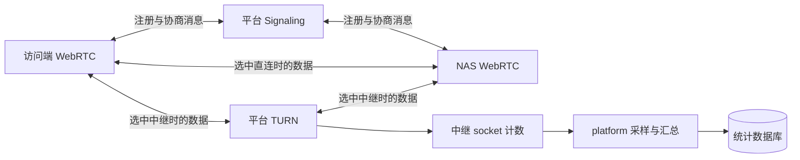
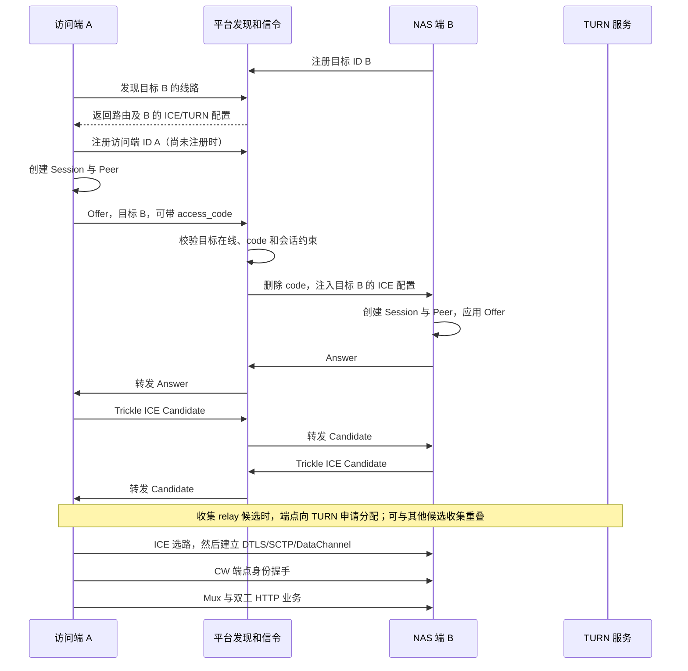

# CW 的 WebRTC 与 TURN：原理、调用流程和改动审核指南

核查日期：2026-09-11。依据当前工作区实现、相对 HEAD 的相关差异及 go.mod 锁定的 Pion WebRTC v4.1.3 / TURN v4.1.3。本文是独立阅读材料，不修改业务源码；源码行号对应本次核查快照。

## 1. 先明确本轮发现

**当前目标 TURN 凭据的 WebRTC 接入存在已复现的缺陷。** `SessionManager` 先创建 PeerConnection，再通过 `SetConfiguration` 设置目标凭据。Pion v4.1.3 的 ICE 收集器在构造 PeerConnection 时已经保存了初始服务器配置；此版本的 `SetConfiguration` 不更新该收集器。

本地回环对照：构造时传入目标凭据，得到 1 个 relay 候选及 1 个 TURN 分配；构造后设置相同凭据，`GetConfiguration` 虽显示 1 个服务器，实际 relay 候选和分配都为 0。第 12 节给出完整因果链、复现方法和建议调整位置。

因此，下面会明确区分协议原理、当前代码意图、实际实现问题与已有验证，不能把“设计上应当如此”当成“当前已经正确”。

## 2. 两个包是什么关系

`pkg/net/webrtc` 是 Go 包，主要运行在连接的端点上，管理 PeerConnection、Session、DataChannel。`pkg/net/webrtc/turn` 虽然位于它的子目录，却是独立 Go 包，主要运行在穿透平台上，封装 TURN 服务器。目录嵌套不表示 WebRTC 的全部数据都会经过这个 TURN 包。

| 部分                             | 运行位置          | 负责什么                                   | 不负责什么                    |
| ------------------------------ | ------------- | -------------------------------------- | ------------------------ |
| `pkg/net/webrtc`               | Go 客户端或 NAS 端 | 单次 WebRTC 会话、信令顺序、DataChannel 交付和关闭    | 平台数据库、文件业务、平台流量报表        |
| `pkg/net/webrtc/signaling`     | 端点与平台各有实现     | 注册、Offer/Answer/Candidate 转发、消息与会话状态校验 | 搬运文件、建立业务端点的长期信任         |
| `pkg/net/webrtc/turn`          | 穿透平台          | 凭据认证、中继地址分配、数据包转发、socket 字节计量          | 理解文件、HTTP、NAS 用户身份       |
| `pkg/net/http/tunnel`          | 端点            | 将 WebRTC、端点身份认证、Mux 和 HTTP 组装起来        | 替代 Pion 实现 ICE/DTLS/SCTP |
| `pkg/net/http/tunnel/platform` | 穿透平台          | 创建信令/TURN 服务、签发凭据、采样、写库、查询             | 在端点上创建业务 PeerConnection  |

浏览器客户端使用浏览器 WebRTC 引擎，Flutter 还有独立接入代码；这份 Go 包说明不能自动证明浏览器或 Flutter 侧行为一致。



上述中继连线是逻辑简图。实际候选对可能是 relay 到直接地址，也可能是两个 relay 地址互通；不要求双方都在同一 TURN 平台创建分配。

## 3. 必须区分的对象

| 对象                      | 含义                    | 与其他对象的关系                             |
| ----------------------- | --------------------- | ------------------------------------ |
| 注册 ID / `route_id`      | 某个平台中的寻址别名            | 可以变化；不等于长期设备身份                       |
| `connection_id`         | 一条信令传输连接              | 一条连接可以注册多个 ID                        |
| `session_id`            | 一次 WebRTC 协商会话        | 用来把 Answer、Candidate、关闭路由到对应 Session |
| `PeerConnection`        | Pion 管理的端到端 WebRTC 连接 | 当前每个 Session 创建独占 Peer               |
| ICE candidate           | 可尝试的网络地址及属性           | 一个 Peer 可以有多个候选                      |
| selected candidate pair | ICE 最终选用的一对本端/远端候选    | 才能用于判断连接实际是否走 TURN                   |
| TURN allocation         | TURN 服务器分配的中继资源       | 不是一个用户，也不等于一次成功隧道                    |
| DataChannel             | WebRTC 上的数据通道         | 建立后仍须完成 CW 的端点身份握手                   |
| `EndpointID`            | CW 的长期端点身份            | 要结合证书、证明及本地信任绑定进行校验                  |
| `access_code`           | 目标线路的接入验证码            | 不是 TURN 密码，也不是 NAS 登录密码              |

同一注册 ID 出现多个 allocation 很正常：多个访问端、多个 Peer、UDP/TCP 候选或重连重叠都可能创建多个分配。ICE 最终选中直连时，之前为收集候选创建的 allocation 也可能存在。

## 4. WebRTC 的协议栈

CW 使用 DataChannel，不以音视频为核心。正常数据路径可以概括为：

```text
NAS HTTP / 文件请求
    ↓
CW 双工 HTTP 与 Mux 虚拟流
    ↓
DataChannel / SCTP
    ↓
DTLS 加密
    ↓
ICE 选中的传输路径
    ├─ 直接地址：端点之间传输
    └─ relay 地址：通过 TURN 转发
```

- **ICE**：收集地址、形成候选对、进行 STUN 连通性检查并选路。
- **STUN**：可以帮助发现 NAT 映射，也用于 ICE 检查；它本身不承担持续中继转发。
- **TURN**：提供可通过服务器收发的 relay 地址，代价是消耗服务器带宽和端口资源。
- **DTLS**：对 WebRTC 传输提供加密。对端的长期 NAS 身份仍需由 CW 身份层验证，不能只信平台传来的 SDP。
- **SCTP / DataChannel**：在选中的传输上提供数据通道，支持可靠或部分可靠等选项。CW 的正常 `Node.Dial` 当前传入默认 DataChannel 选项；不能把裸 UDP 测试的“一个包超时即失败”直接等同于该数据通道的行为。

ICE、DTLS、SCTP 由 Pion 实现。CW 的 `Session` 管理调用时机和失败处理，没有重新实现这些协议。

### 4.1 P2P 与 TURN 是不是先后两次连接

默认 `ICETransportPolicyAll` 下可以同时收集 host、srflx、relay 等候选。ICE 对候选对进行检查和选择，不是 CW 先执行一遍独立 P2P 程序，失败后再执行一遍独立 TURN 程序。

| 候选类型 | 来源 |
| --- | --- |
| host | 本地网络接口地址 |
| srflx | 通过 STUN 得到的映射地址 |
| prflx | 在连通性检查中发现的对端映射信息 |
| relay | 通过 TURN Allocate 得到的中继地址 |

`relay` 策略限制使用中继候选；`all` 允许多种候选，但不能承诺任意网络都直连成功，也不能保证永远选择某条路径。审核时应看运行中的 selected candidate pair，而不是只看服务器已配置或 allocation 数量。

## 5. 一次 CW 连接如何建立

以下以访问端 A 连接目标注册 ID B 为例；“目标配置应用到 Peer”是当前实现意图，实际注入时机缺陷见第 12 节。



调用起点是 [Node.Dial](/home/skynit/workspace/cw/pkg/net/http/tunnel/node.go:295)。它先等待信令注册就绪，再调用 `SessionManager.CreateSession`，随后 `OpenDataChannel`；得到通道后通过 `identity.AuthenticateWebRTCInitiator` 验证对端，最后建立 `HTTPConnection`。

平台发现 428 只给出连接所需的信息；register_ok 只确认注册；Offer ACK 只确认平台接收/转发流程；Peer connected 也不等于 NAS 业务身份认证完成。审核不能跳过后面的阶段。

## 6. `webrtc` 包的源码分工

### 6.1 `peer.go`：真正的连接构造边界

[NewPeerFactory](/home/skynit/workspace/cw/pkg/net/webrtc/peer.go:36) 每次构造独立 Pion PeerConnection，复制 SettingEngine，开启 DataChannel detach，再调用 `api.NewPeerConnection(config.Configuration)`。

`PeerConnection` 接口让 Session 能使用生产 Pion，也能在测试里使用 fakePeer。接口模拟可验证参数传递，但不能替代 Pion 的真实行为。当前新增 `GetConfiguration/SetConfiguration` 就存在这一验证盲区。

审核关键：正确的每会话 ICE 配置、原有证书、传输策略、SettingEngine 应在实际使用时生效；不同目标不能污染共享 Node 配置。

### 6.2 `session_manager.go`：管理多个会话

[CreateSession](/home/skynit/workspace/cw/pkg/net/webrtc/session_manager.go:207) 校验本地/目标路由，分配 session_id，预留容量，再创建 Peer 和 Session。入站消息由 [processMessage](/home/skynit/workspace/cw/pkg/net/webrtc/session_manager.go:268) 处理：新的 Offer 创建 responder，其余消息按 session_id 分发到已有 Session。

入站 [acceptOffer](/home/skynit/workspace/cw/pkg/net/webrtc/session_manager.go:291) 读取平台注入的 ICE 配置，创建 responder，应用 Offer、生成 Answer，然后发布入站 Session。容量预留防止并发创建越过会话数量限制。

Manager 拥有 Session，关闭时关闭全部会话并等待 watcher；外部传入的 signaling.Client 不归 Manager 所有。整体 Node 再负责信令客户端的生命周期。

### 6.3 `session.go`：单次会话状态机

发起端 [OpenDataChannel](/home/skynit/workspace/cw/pkg/net/webrtc/session.go:248) 的顺序是：

1. idle 进入 negotiating。
2. 创建 DataChannel 并安装打开/错误回调。
3. CreateOffer，然后 SetLocalDescription。
4. 发送 Offer 并等待信令 ACK。
5. 释放此前暂存的本地 Candidate。
6. 等待 DataChannel 打开并 detach，以及身份会话上下文就绪。

接收端 [acceptOffer](/home/skynit/workspace/cw/pkg/net/webrtc/session.go:338) 先检查会话方向和 access_code 已被平台删除，SetRemoteDescription，再 CreateAnswer、SetLocalDescription、发送 Answer，最后释放本地 Candidate。

**Candidate 顺序很重要。** [runLocalCandidates](/home/skynit/workspace/cw/pkg/net/webrtc/session.go:654) 在描述获得 ACK 前暂存本地候选；[applyRemoteCandidate](/home/skynit/workspace/cw/pkg/net/webrtc/session.go:811) 在远端描述设置前暂存远端候选；设置完远端 SDP 后再 AddICECandidate。队列有上限，超限返回错误并终止，而不是无限堆积。

detach 表示 Pion 在 DataChannel 打开后交出 ReadWriteCloser；它仍运行在 WebRTC 协议栈上，不是绕过加密的裸 socket。上层通过 `conn/datachannel` 适配为 net.Conn，再执行 CW 身份握手。

### 6.4 错误和关闭

[handlePeerState](/home/skynit/workspace/cw/pkg/net/webrtc/session.go:487) 当前将 Disconnected 和 Failed 都视为会话失败并关闭。因此，不应宣称本项目已有透明 ICE Restart 或断线后无缝恢复原 HTTP 请求。信令重新注册也不等于旧 Peer 或 HTTP 流恢复。

[shutdown](/home/skynit/workspace/cw/pkg/net/webrtc/session.go:899) 通过 once 保证只执行一次；按需发送 session_close，取消工作者，关闭 Peer，等待工作者退出，保留错误并关闭 done。已交付的 DataChannel/外层连接有上层所有权，未交付或迟到的通道需要正确回收。

## 7. `signaling` 如何支撑两个包

信令负责控制消息，业务数据走 DataChannel/TURN。平台的[注册入口](/home/skynit/workspace/cw/pkg/net/webrtc/signaling/routes/routes.go:45) 是登录前协议入口，不要求 NAS 用户登录。注册状态保存 route_id、连接绑定和 code 摘要，并处理在线冲突，不验证“这个进程是不是官方 CWNAS”。

[relayOffer](/home/skynit/workspace/cw/pkg/net/webrtc/signaling/server.go:471) 校验源 ID 属于当前连接，检查目标在线、线路 code、session_id 和会话上限。它拒绝端点主动夹带 `ice_servers`，删除 access_code，再由平台注入目标 B 的 ICE 配置，避免把 A 提供的任意配置直接交给 B。

注入的数据结构与校验位于 [ice.go](/home/skynit/workspace/cw/pkg/net/webrtc/signaling/ice.go:14)。`ICEServers` 包含地址、用户名、凭据，不包含签名密钥；这里的输入校验约束 URL、字段和数量，不构成平台使用授权。

审核时尤其要区分：Offer 转发路径有在线/code 校验；公开发现签发路径没有等价的校验。两条路径调用同一个签发函数，并不意味着授权条件相同。

## 8. TURN 服务器到底做了什么

### 8.1 监听器、中继 socket 和客户端角色

[turn.NewServer](/home/skynit/workspace/cw/pkg/net/webrtc/turn/server.go:52) 配置 Pion TURN 服务、认证回调、中继地址生成器、分配事件和计量器。每份 SocketConfig 创建对应 UDP PacketConn 或 TCP Listener；构造途中出错会回收已创建资源。

```text
TURN 客户端
  ↕ UDP 或 TCP，平台入口 9087
TURN 协议处理器
  ↕ 去除/添加 TURN 封装
分配出的 UDP 中继 socket，端口位于 50000–60000
  ↕ UDP
对端地址（可以是对端直接地址，也可以是另一个 relay 地址）
```

`TCP TURN` 指客户端通过 TCP 连接 TURN 服务；当前配置的中继侧仍是 UDP。这不是“把两个端点之间的全部网络都改成 TCP”。公网 IP 是返回给客户端的可达地址，本地绑定地址可以是云主机私网地址，两者不能混淆。

### 8.2 从 Allocate 到数据转发

1. **Allocate**：客户端申请中继资源。典型长期凭据认证先返回 realm/nonce 挑战，客户端用凭据生成请求完整性认证后重试；初始 401 挑战不等于最终失败。
2. **AuthHandler**：CW 返回该用户名对应的认证密钥，Pion 校验消息完整性。仅知道用户名、ID 或有效期不能伪造签名密码。
3. **QuotaHandler**：当前 CW 动态凭据实现用它检查新 allocation 的有效期。虽然回调名含 quota，这段代码没有实现每 ID 字节配额或完整的每 ID 分配数量配额。
4. **分配 relay socket**：Pion 通过 `RelayAddressGeneratorPortRange` 分配端口；CW 的 `meterRelay` 包装该 socket。
5. **分配事件**：OnAllocationCreated 取得用户名与 relay 地址，解析 ID，把对应 socket 绑定到统计 ID。
6. **CreatePermission**：建立允许访问的 peer IP。它不是 NAS 登录授权，也不是把 peer 证明为凭据里的注册 ID。
7. **Send Indication / ChannelData**：客户端将发给 peer 的数据交给 TURN；ChannelBind 建立通道号与 peer 地址映射后，可以减少数据封装开销。服务端向 relay socket WriteTo，收到 peer 数据则 ReadFrom 后封装回客户端。
8. **Refresh / 释放**：客户端刷新 allocation 生命周期；停止刷新会超时回收，也可以用零 lifetime 的 Refresh 释放。

TURN 服务器主要转发字节，正常 CW WebRTC 使用时其中通常是 ICE 检查和加密的 WebRTC 数据。当前实现没有检查载荷必须是 WebRTC，更不会解析里面的 HTTP；所以非 CWNAS 程序持有有效凭据也能转发测试数据。

### 8.3 Permission 不是 ID 绑定

当前 [server.go](/home/skynit/workspace/cw/pkg/net/webrtc/turn/server.go:121) 没有配置与目标 ID 对应的 PermissionHandler。Pion v4.1.3 的[默认处理](/home/skynit/go/pkg/mod/github.com/pion/turn/v4@v4.1.3/server_config.go:30) 允许 peer 地址，仍遵守 TURN permission/channel 协议。

所以“凭据里写着 B”代表计量标签 B，不代表 TURN 实际只允许向 B 这个 NAS 转发。它没有把目标 ID 与真实 peer IP、端点证书、session_id 建立强制绑定。

## 9. 凭据：签名、时效、归属与授权

[Credentials.Issue](/home/skynit/workspace/cw/pkg/net/webrtc/turn/credentials.go:34) 生成：

```text
username = route:<过期时间>:<编码后的目标注册 ID>
password = HMAC-SHA256(平台运行期随机密钥, username) 的编码
```

密钥在平台启动时生成，仅服务端持有。用户名里的 ID 是可编码/解码的标签，并非秘密。同一 ID 在同一时间窗口复用凭据，不是每个 session_id 一份唯一凭据。

设窗口为 W，过期时间是当前窗口起点 + 2W。因此默认 W=1 小时时，新分配有效时长大致为 1 到 2 小时，不能描述成固定“签发后 1 小时”。

| 条件 | 当前行为 |
| --- | --- |
| 新 allocation 使用未过期的有效签名 | 可以通过凭据检查 |
| 新 allocation 使用已过期凭据 | Allow 拒绝 |
| 已有 allocation 使用过期凭据刷新 | Get 仍可生成认证密钥，允许维持已有分配 |
| 目标 ID 离线、信令 session_close | 当前没有联动撤销该 ID 的全部 TURN 凭据或分配 |
| 平台进程重启 | 随机签名密钥变化；旧凭据不能再通过新进程认证，旧进程分配也不能直接延续 |
| 仅知道 ID 或伪造 username | 不等于持有正确 HMAC 密码 |

**签名可靠与签发授权充分是两件事。** 当前[发现入口](/home/skynit/workspace/cw/pkg/net/http/tunnel/routes/routes.go:564) 免登录，解析合法寻址信息后直接调用 ICE 签发函数；[平台签发](/home/skynit/workspace/cw/pkg/net/http/tunnel/platform/service.go:99) 没有查询目标在线或访问者权限。按源码，这里甚至没有要求必须先完成信令注册。上一轮实测走的是“非 CWNAS 程序注册后领凭据”的路径，未另行实测不注册分支。

因此，现有目标 ID 标签支持运营观察，不能直接当成可信设备归属或计费授权。取消共享静态密码没有自动补齐签发入口授权；若要求仅授权端点使用中继，需要独立完善接入和签发规则。

## 10. 流量到底在哪里统计

### 10.1 精确计量位置和方向

[meterPacket.ReadFrom / WriteTo](/home/skynit/workspace/cw/pkg/net/webrtc/turn/meter.go:91) 包装的是 **relay socket**，不是 TCP/UDP 9087 的外层监听器，也不是整张网卡。

| 数据方向 | relay socket 操作 | 当前统计字段 |
| --- | --- | --- |
| TURN 客户端交给服务器，服务器发给 peer | WriteTo | Send |
| peer 发给中继地址，服务器读取并准备回送客户端 | ReadFrom | Receive |

代码累计实际返回的 `n > 0`，即使同次返回还有错误也计入已经读写的字节；不按请求 buffer 长度猜测。UDP WriteTo 成功意味着内核接受了发送数据，不证明远端最终收到。

这里包括穿过 relay socket 的协议载荷，例如 ICE 连通性检查、DTLS/SCTP 开销和重传数据；不包含该 socket 下方的 IP/UDP 头，也不包含客户端到 TURN 入口上所有 Allocate/Refresh、TCP、TURN 封装开销。因此不能把它当作文件大小或云账单网卡流量。

### 10.2 为什么总量可能不是文件大小

一个 1024 字节包经过两个都在本平台的 relay allocation 时，发送 allocation 记 Send=1024，接收 allocation 记 Receive=1024，平台收发合计为 2048。若两个 allocation 使用同一个目标 ID，该 ID 的合计也会包含这两份 socket 操作。这是当前“中继收发量”的口径，不是唯一业务载荷去重后的字节。

只在一侧使用本平台 relay 时，计量事件又不同。审核指标必须依据实际计量点，不能把所有拓扑都套用“文件大小乘二”。

### 10.3 并发、领取增量和关闭尾量

`Meter` 保存活动 meterPacket 与已关闭 socket 的 pending 字节。`Drain` 是单消费者领取增量：先移交 pending，再取出已绑定活动 socket 的增量并清零。平台每次采样取得的数不能再次领取。

`meterPacket.Close` 先禁止新 I/O，关闭底层 socket 来解除读写阻塞，等待已经开始的 I/O 完成计数，再把剩余字节移到 pending 并移除活动 socket。once 防止重复转移尾量。bind、Drain、Close 的锁序和端口复用需要一起审查。

### 10.4 从计量到数据库

`platform.Service` 是拥有者；[StartStats](/home/skynit/workspace/cw/pkg/net/http/tunnel/platform/stats.go:119) 接入主数据库和 TURN Meter，默认每 5 秒采样，按实际采样间隔计算当前速率，每 30 秒批量写库。

`tunnel_traffic` 按目标 ID 保存累计行 bucket=0 和 UTC 小时行。小时趋势默认保留 30 天，累计用量不随趋势清理。小时记录按领取增量的时间归桶，不是每个包的精确发生时间，跨小时附近存在采样粒度。

[flush](/home/skynit/workspace/cw/pkg/net/http/tunnel/platform/stats.go:248) 冻结批次，通过事务写累计/小时/采集完整性和状态；批次 ID 避免提交结果不确定时重试重复计数。写库错误保留批次，统计缓冲超限会标记缺失。异常终止可丢失尚未落盘的增量；正常关闭会尝试保存尾量。

计数器到 Meter 的底层累加仍是 uint64；不能因为上层保存使用十进制字符串或排序保留进位，就宣称所有累计层都无限精度或都有溢出保护。

## 11. 关闭顺序和资源所有权

| 层 | 拥有的资源 | 关键关闭责任 |
| --- | --- | --- |
| Node | 信令客户端、Manager、HTTPConnection | 结束业务与会话，再释放共享信令 |
| SessionManager | Session 集合及 watcher | 停止创建，关闭会话，等待 watcher |
| Session | Peer、工作者、未交付通道 | 幂等关闭 Peer，取消并等待工作者，保留错误 |
| 上层 HTTPConnection | 已交付通道的外层连接 | 关闭 Mux/HTTP 流与底层连接 |
| TURN Server | UDP/TCP 监听、Pion TURN 实例、Meter | 关闭监听和接受的 TCP 连接、回收 relay socket |
| platform.Service | TURN、Signaling、统计任务 | 先关闭 TURN 收尾，再停止统计并尝试最终写库；不关闭注入的主 DB |

新增 [listener.go](/home/skynit/workspace/cw/pkg/net/webrtc/turn/listener.go:8) 跟踪 TCP Listener 接受的连接，因为仅关闭监听器不代表已接受连接的 Read 自动解除。此部分是资源关闭支撑，不是字节统计或 P2P 算法修改。

## 12. 已确认缺陷：目标凭据在错误时机注入

### 12.1 CW 当前调用

[createReservedSession](/home/skynit/workspace/cw/pkg/net/webrtc/session_manager.go:410) 的实质是：

```go
peer, err := m.peerFactory() // 这里已经执行 Pion NewPeerConnection
// ...
config := peer.GetConfiguration()
config.ICEServers = sessionServers
err = peer.SetConfiguration(config)
```

### 12.2 Pion v4.1.3 的实际行为

1. [NewPeerConnection](/home/skynit/go/pkg/mod/github.com/pion/webrtc/v4@v4.1.3/peerconnection.go:162) 初始化 configuration 后立即调用 createICEGatherer。
2. [createICEGatherer](/home/skynit/go/pkg/mod/github.com/pion/webrtc/v4@v4.1.3/peerconnection.go:743) 将当时的 ICE servers 与 gather policy 传进去。
3. [NewICEGatherer](/home/skynit/go/pkg/mod/github.com/pion/webrtc/v4@v4.1.3/icegatherer.go:50) 解析并保存 `validatedServers`；后续 Agent 使用这份列表。
4. [SetConfiguration](/home/skynit/go/pkg/mod/github.com/pion/webrtc/v4@v4.1.3/peerconnection.go:514) 更新 configuration 字段，但没有更新已经创建的收集器。该方法对空 ICEServers 也不会按“清空列表”处理。

所以“还没开始 Gather，先调用 SetConfiguration 就可以”这一假设不成立。应核对依赖的实际实现，不能把浏览器同名 API 或 fakePeer 的行为直接套用。

### 12.3 本轮真实回环复现

工具：[peer-config-check.go](/home/skynit/workspace/build/turn-vm-20260911/peer-config-check.go)。它调用项目的 `NewPeerFactory` 与 `turn.NewServer`，使用有效目标签名、回环 UDP TURN 和 relay-only 策略，只验证真实候选收集，不发起公网业务传输。

```sh
go run /home/skynit/workspace/build/turn-vm-20260911/peer-config-check.go
```

实际输出：

```json
{"mode":"constructor","configured_servers":1,"relay_candidates":1,"allocations":1}
{"mode":"set_after_constructor","configured_servers":1,"relay_candidates":0,"allocations":0}
```

这已经证明当前接入方式不能保证新目标配置用于实际 ICE 收集。基础配置没有 TURN 时，新目标 TURN 可能完全不被使用；基础配置已有 TURN 时，则可能继续使用构造时的旧地址或凭据。P2P 仍可成功时，这个问题可能被掩盖，直到需要中继才暴露。

### 12.4 为什么之前的验证没有发现

- [fakePeer 配置测试](/home/skynit/workspace/cw/pkg/net/webrtc/session_test.go:152) 只是把结构体赋给字段，没有模拟独立 ICEGatherer。本轮该测试实际运行仍 PASS。
- 原有真实 Pion DataChannel 测试调用 CreateSession 时传 nil ICE，没有覆盖新凭据注入路径。
- 多虚拟机 TURN 工具直接创建 Pion TURN Client，绕过了 SessionManager 和 PeerConnection，因此它的成功只证明 TURN 服务端路径可用。

本轮执行：`go test ./pkg/net/webrtc -run '^TestResponderConfigurationPreservesPolicyAndCopiesServers$' -v`，结果通过；没有执行全仓测试。

### 12.5 建议调整方向，尚未实施

每会话 ICE 配置应在 `api.NewPeerConnection` 之前合入独立配置。可以让 PeerFactory 接受本次 ICE 配置，在工厂内复制基础配置后替换 ICE servers，再构造 Peer。发起和接收路径都应经过同一个构造边界，并保留 SettingEngine、证书及原有传输策略。

这样可重新评估 `PeerConnection` 接口是否还需要仅为本次需求新增的 GetConfiguration/SetConfiguration。不要为绕过本问题引入没有完整身份和信令支持的 ICE Restart 流程。

验证应包含真实 Pion + 本地 TURN、两个不同目标凭据、原配置为空/非空，以及选中 relay 后完成 DataChannel 传输；再做正式 NAS 和客户端的端到端验收。这里只提出审核结论和修正方向，没有修改业务源码。

## 13. 审核本次改动时逐项核对

| 审核对象 | 应满足的条件 | 当前状态或证据 |
| --- | --- | --- |
| TURN 字节计量 | 只计实际 n，部分 I/O 也计，关闭不丢尾量不重复领取 | 有相关包内测试及直接 TURN 测试证据；仍应审阅并发实现 |
| 统计方向 | 明确 relay socket Receive/Send，而非文件上下行或网卡总量 | 代码位置明确，产品解释需要沿用同一口径 |
| 目标凭据注入 | 真实 ICE 收集器使用本次目标凭据 | 已复现不满足，见第 12 节 |
| 多目标隔离 | A/B 连接使用各自凭据，共享 Node 不污染配置 | 参数传递有模拟测试，真实 WebRTC 新配置路径尚未通过 |
| Offer 注入 | 平台注入，拒绝客户端指定平台 ICE 配置 | 当前有相应信令测试 |
| 凭据授权 | 只有获准请求能取得凭据，并按产品规则限制目标 | 当前公开发现路径缺少该约束 |
| 凭据有效期 | 明确新分配和已有 Refresh 的不同策略 | 当前是新分配过期拒绝，已有刷新允许 |
| Peer 目的地 | 标签 B 是否强制绑定实际 B | 当前没有这种强绑定 |
| 静态接入 | 生产平台不生成/发布/使用共享静态凭据 | 平台注入 Credentials；通用 credential 包仍有测试/通用类型，不能只按类型是否存在判断生产路径 |
| 统计持久化 | 分批、幂等、重启可查、失效可见 | 已有数据库及直接中继测试；不是逐包无损账本 |
| 错误恢复 | 不把信令重连称作业务恢复 | 当前 Session 在 Disconnected/Failed 时关闭 |
| 测试证据 | fake、真实库、真实平台、完整 NAS 链路明确分开 | 目前完整 NAS P2P/强制 TURN 链路仍未验收 |

## 14. 已有实测究竟证明了什么

| 验证 | 已证明 | 没证明 |
| --- | --- | --- |
| 三台虚拟机 TURN-over-TCP 4096 轮 | 公网 TURN 认证、双向数据、按 ID 落盘正确 | 正式 PeerConnection 使用目标凭据、NAS 登录/文件功能 |
| 后续 UDP 开放测试 | UDP 入口可达、Allocate 成功、能转发部分数据 | UDP 连续逐包测试稳定性；该测试出现接收超时 |
| 服务器本地对照 | 本地 TURN 认证、转发与计量 | 跨 NAT 的 P2P 或完整业务 |
| fakePeer 配置测试 | 调用方传了配置并保留字段/切片隔离 | Pion 的 ICEGatherer 实际使用新配置 |
| 本轮 Peer 配置回环对照 | 构造时配置有效，创建后设置不生效 | 修正后完整链路可用；本轮没有实施修正 |

前面平台上出现的 vm-probe、vm-retest 等 ID 来自测试程序，流量是真实 TURN 流量，但不是完整 NAS 文件业务。三台虚拟机独立运行、共享宿主出口，不能称为跨运营商覆盖。

## 15. 建议阅读顺序

1. [peer.go](/home/skynit/workspace/cw/pkg/net/webrtc/peer.go)：明确构造时机和 Pion 接口。
2. [SessionManager](/home/skynit/workspace/cw/pkg/net/webrtc/session_manager.go:207)：跟踪本次 ICE 配置和 session_id。
3. [Session.OpenDataChannel](/home/skynit/workspace/cw/pkg/net/webrtc/session.go:248)：对照 Offer/Answer/Candidate 顺序。
4. [平台 relayOffer](/home/skynit/workspace/cw/pkg/net/webrtc/signaling/server.go:471)：区分 code 校验与配置注入。
5. [平台 ICEServers](/home/skynit/workspace/cw/pkg/net/http/tunnel/platform/service.go:81) 与 [Credentials](/home/skynit/workspace/cw/pkg/net/webrtc/turn/credentials.go:14)：核对标签、签名和时效。
6. [TURN NewServer](/home/skynit/workspace/cw/pkg/net/webrtc/turn/server.go:52)：核对认证、分配、事件与计量器连接。
7. [Meter](/home/skynit/workspace/cw/pkg/net/webrtc/turn/meter.go:17)：核对计量口径、并发和尾量。
8. [platform stats](/home/skynit/workspace/cw/pkg/net/http/tunnel/platform/stats.go:119)：核对单消费者采样、数据库与查询。
9. [Node.Dial](/home/skynit/workspace/cw/pkg/net/http/tunnel/node.go:295)：确认身份认证完成后才进入 Mux/HTTP。
10. 最后对照第 12、13、14 节，判断改动是否只是参数上看似成立，还是已经有真实执行证据。
