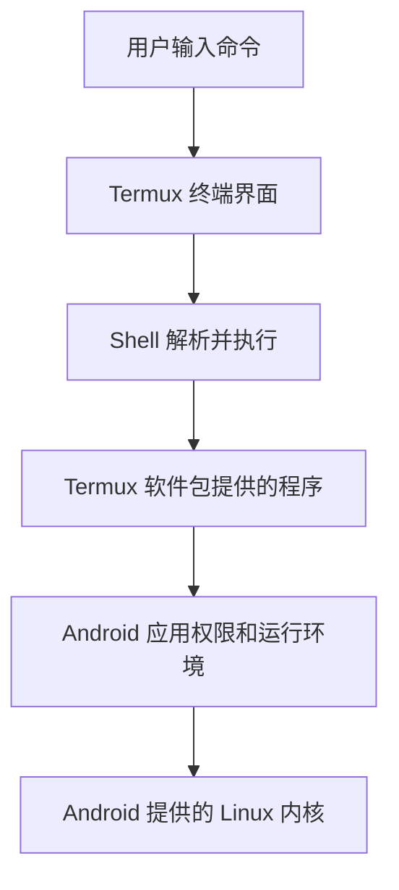

# Termux 入门与实践

**Termux 是运行在 Android 上的终端应用与命令行软件环境。** 安装后可以在手机或平板上使用 Shell、Python、Git、SSH 等工具；基础使用不要求取得手机 root（系统最高身份）权限。它适合学习命令行、运行脚本、远程管理服务器和处理文件。[^S01]

其中，**Shell** 是解释并执行命令的程序，由 Termux 启动；**Python** 是可以执行脚本的编程语言及运行时；**Git** 是开发者管理文件版本的工具；**SSH** 是客户端与远端服务之间进行加密登录和命令执行的协议。这些工具需要按用途安装，不是打开终端后自动获得全部能力。

本文中的 **NAS（网络附加存储）** 指用户部署在家庭或公司网络、提供文件和管理服务的存储设备；CWNAS 是本知识库所属的 NAS 项目。

资料查阅日期为 **2026-10-21**。本文以 Termux 官方 F-Droid/GitHub 主线环境为主要说明对象，单独交代 Google Play 分支差异。命令是学习示例，**本次整理没有在手机上安装软件、启动服务或执行文件同步**；示例地址、账号和端口不代表 CWNAS 当前配置。

## 阅读导航

- [[#1. Termux 由哪些部分组成|基本原理与能力边界]]：第 1～3 节。
- [[#4. 第一次启动与软件包管理|安装后的入门操作]]：第 4～6 节。
- [[#7. 用手机连接 NAS 或服务器|SSH 与文件传输]]：第 7～8 节。
- [[#9. 后台任务、会话与 Android 电源管理|后台运行与扩展能力]]：第 9～12 节。
- [[#13. 与 CWNAS 结合的使用场景|CWNAS 场景、备份与排障]]：第 13～15 节。
- [[#16. 官方参考资料|官方参考资料]]：第 16 节，正文脚注可定位来源。

## 1. Termux 由哪些部分组成

| 部分 | 是什么、由谁创建或配置 | 负责什么，与相近对象的区别 |
| --- | --- | --- |
| 终端界面 | Termux 应用提供的输入输出界面 | 显示文字、接收键盘和处理终端控制，不负责解释全部命令 |
| Shell | 应用启动的命令解释器，用户可选择 Bash 等实现 | 解析命令、变量、管道和脚本，调用其他程序 |
| 软件包环境 | Termux 维护者为 Android 构建的软件，由用户安装 | 提供 Git、Python、OpenSSH 等命令，不等于完整 Ubuntu 系统 |
| Android 应用沙箱 | Android 在安装应用时配置的用户身份和访问规则 | 约束 Termux 能访问哪些文件、系统资源和其他应用数据 |
| Android/Linux 内核 | 手机系统提供的底层内核 | 调度进程、内存和网络；Termux 默认不会另外启动一个内核 |

**进程** 是操作系统正在运行的程序实例；Shell 执行外部命令时通常创建或启动相应进程。Termux 默认在 Android 宿主环境原生执行适配后的程序，不需要为每条命令启动虚拟机。[^S03]



这解释了两个看起来相反、其实可以同时成立的事实：Termux 能运行很多熟悉的 Linux 工具；它仍受 Android 的目录布局、库、权限和后台进程规则约束。[^S03][^S04]

## 2. 与普通 Linux、虚拟机和 root 的区别

| 概念 | 主要作用 | 与 Termux 基础环境的关系 |
| --- | --- | --- |
| 普通 Linux 发行版 | 组合内核、系统服务、软件库和包管理，形成完整系统 | Termux 提供相似的命令行体验，但目录、底层库和权限模型不同 |
| 虚拟机 | 由虚拟化软件创建虚拟硬件并运行客体系统 | Termux 默认直接使用 Android 内核，不属于这种运行方式 |
| root 权限 | Android/Linux 的最高权限身份，需要设备另行授权或配置 | 安装 Termux 不会自动取得；普通包管理和 SSH 客户端不需要它 |
| PRoot 环境 | 工具在用户态调整程序看到的路径等行为 | 可在 Termux 中运行其他发行版的用户空间，不提供新的内核和真正系统权限 |
| SSH 远程登录 | 通过网络连接另一台机器执行命令 | 登录后执行位置在远端，手机主要承担输入输出和连接 |

**用户空间** 是普通程序及其运行库所在的执行层，与内核提供的底层系统能力相对。**运行库** 是程序共同使用的基础代码；Termux 原生软件通常针对 Android 的 Bionic 库构建，常见桌面 Linux 程序则可能依赖 glibc。即使两者都使用 ARM64 处理器，也不能推断下载的 Linux 二进制能在 Termux 直接运行。[^S03]

**ARM64/aarch64** 是一种 64 位处理器指令体系，由硬件和系统支持；它描述程序机器指令的兼容性，不等于文件路径、动态库和 Android 权限也都兼容。

因此，安装软件优先使用 Termux 软件仓库；确实需要发行版环境时，再评估第 12 节的 PRoot-Distro。不要把教程中的 `sudo apt install`、`systemctl` 和固定 `/usr/bin` 路径原样套入基础 Termux 环境。[^S03][^S04]

## 3. 安装渠道与版本兼容

**APK** 是 Android 应用安装包，由发布方构建并签名；**应用签名** 是 Android 验证更新与应用身份的机制。它与安装后下载命令行工具的软件仓库签名是不同层次。

| 渠道 | 谁提供什么 | 使用时关注什么 |
| --- | --- | --- |
| F-Droid | 开源 Android 应用目录及其构建、签名发布体系 | 主程序和插件采用兼容来源，更新节奏可能晚于上游发布 |
| 官方 GitHub | Termux 项目发布安装包和构建产物 | 从官方项目入口选择包；区分发布版和测试构建 |
| Google Play | 独立仓库维护、为商店要求调整的分支 | 功能、权限和插件支持应按该分支文档核对 |

本次读取的主项目说明将完整应用与软件包支持范围列为 Android 7 及以上，并说明 Google Play 有适用于 Android 11 及以上的独立实验分支，其功能与主线仍有差异。因此，“Play 商店版本已经完全停止更新”属于不能直接沿用的历史说法；本文不固定一个所谓永远最新的版本号。[^S02]

主线 Termux 与插件需要兼容的应用签名，官方要求从同一来源安装，不能随意混用 F-Droid 与 GitHub 包。切换渠道涉及重装时，应先导出私有目录里的脚本、配置及凭据；卸载会删除应用专属数据。[^S02][^S18]

官方 GitHub 构建的签名方案也与 F-Droid 不同；主项目特别说明其测试签名密钥公开，因此应从官方仓库获取对应构建，不能只凭“能够覆盖安装”判断第三方包可信。[^S02]

## 4. 第一次启动与软件包管理

### 4.1 区分应用更新与包更新

Termux 应用本身通过所选 Android 安装渠道更新；进入终端后的软件由包管理器安装和更新。本文主要说明使用 **APT** 的主线环境：APT 是按仓库索引解决依赖并安装软件包的系统；**`pkg`** 是 Termux 提供的便捷封装，由 Termux 工具包维护。[^S05]

在手机 Termux 中执行的入门示例：

```bash
# 更新软件列表，再更新已安装软件。
pkg update
pkg upgrade

# 安装按本文示例使用的基础工具。
pkg install git python openssh curl nano tmux
```

`update` 主要刷新可用包信息，`upgrade` 更新已安装包；`install` 下载并安装指定工具及依赖。命令可能提示下载量、升级范围和确认信息，阅读后再按自己的环境决定。Termux 采用滚动更新方式，长期不更新后直接安装新包，可能遇到依赖与仓库变化。[^S05]

常用查询命令：

```bash
# 按名称或说明搜索。
pkg search openssh

# 查看已经安装的包。
pkg list-installed

# 显示便于排障的 Termux 环境信息。
termux-info
```

**镜像站** 是提供软件仓库副本的服务器，由相应运营方维护，客户端按配置下载包。连接异常时可以使用 `termux-change-repo` 选择可达的 Termux 镜像，然后重新更新索引；不应把 Termux 仓库改成 Ubuntu/Debian 仓库。[^S06]

```bash
termux-change-repo
pkg update
```

### 4.2 常见工具各做什么

| 包或命令 | 主要用途 | 使用边界 |
| --- | --- | --- |
| `git` | 获取项目、查看文件变更、管理版本 | 主要项目目录放在应用私有工作区，避免共享存储的属性限制 |
| `python` | 执行 Python 脚本和简单开发任务 | 第三方原生扩展还需兼容 Android 和本机架构 |
| `openssh` | 提供 SSH 客户端、服务端及文件传输工具 | 安装后不等于已启动服务或授予 NAS 权限 |
| `curl` | 发出网络请求、下载或查看响应 | HTTP 请求成功不等于其他协议也可用 |
| `nano` | 在终端编辑文本 | 与图形编辑器相比，更依赖快捷键 |
| `tmux` | 组织多个终端窗口并分离/重接会话 | 不替代 Android 进程存活保障，见第 9 节 |

## 5. 目录、存储与权限

### 5.1 先认识三个位置

**环境变量** 是进程携带的命名设置，由系统、应用或 Shell 配置；程序可以读取它们确定路径和行为。`$HOME` 是当前用户工作主目录，`$PREFIX` 是 Termux 软件安装前缀。**`~`** 是 Shell 中常用的主目录缩写，通常指向 `$HOME`。[^S04]

| 路径 | 由谁维护 | 适合放什么 |
| --- | --- | --- |
| `$HOME`，常见为 `/data/data/com.termux/files/home` | Termux 使用的应用私有工作区 | 项目、脚本、SSH 配置、程序状态 |
| `$PREFIX`，常见为 `/data/data/com.termux/files/usr` | Termux 包管理器维护 | 命令、库和配置；通常不手动挪动或整体覆盖 |
| `~/storage/shared`、`~/storage/downloads` | 初始化后创建的共享存储访问入口 | 与 Android 文件应用交换的文档、下载内容 |

表中的绝对路径是典型主线安装示例；程序中优先读取实际变量，不在更换包名、用户资料或不同构建后盲目假定路径相同。[^S04]

```bash
printf 'HOME=%s\nPREFIX=%s\n' "$HOME" "$PREFIX"
pwd
ls -la "$HOME"
```

### 5.2 访问下载目录

```bash
# 按系统提示授予该版本支持的共享存储访问权限。
termux-setup-storage

# 查看创建的入口及下载目录。
ls -l "$HOME/storage"
ls "$HOME/storage/downloads"
```

`termux-setup-storage` 协调存储访问并建立相关入口，不是取得其他应用私有目录的万能授权。Android 版本、目标版本与设备策略会影响实际可访问范围；只在文件管理器中看得到某个文件，不等于 Termux 可通过任意路径读取。[^S05][^S18]

**符号链接** 是文件系统中指向另一个路径的特殊对象，由系统或程序创建；`~/storage` 下的入口通常通过链接指向共享存储。因此，路径看起来以 `$HOME` 开头，不代表最后访问的就是私有文件系统。[^S03]

### 5.3 为什么项目尽量放在私有目录

Android 共享存储与普通 Linux 工作目录在可执行权限、链接和大小写等语义上存在差异，还可能以禁止直接执行程序的方式挂载。Git 仓库、编译产物和运行环境放在共享目录中，容易出现属性或执行问题。推荐在 `$HOME/projects` 开发，按需将成果复制到共享目录。[^S03]

```bash
mkdir -p "$HOME/projects" "$HOME/scripts"
cd "$HOME/projects"
```

脚本也应优先保存在私有目录。Linux 教程里的脚本头部若固定写了手机上不存在的解释器路径，会导致启动失败；对自己编辑的可信脚本，可以明确用 `bash 路径` 或 `python 路径` 调用相应解释器，先分清路径、权限与文件格式问题。[^S03][^S04]

## 6. 基本操作与本地脚本

### 6.1 常用命令与按键

| 操作 | 命令或按键 | 说明 |
| --- | --- | --- |
| 查看当前位置 | `pwd` | 判断是在手机目录还是 SSH 登录后的远端目录 |
| 查看文件 | `ls -la` | 显示隐藏项和常见属性 |
| 切换目录 | `cd 路径` | 路径含空格时用引号包围 |
| 创建目录 | `mkdir -p 路径` | 创建缺少的父目录，已有目录可复用 |
| 编辑文本 | `nano 文件名` | 常用保存键为 Ctrl+O，退出为 Ctrl+X |
| 中断前台任务 | Ctrl+C | 向当前任务发送中断请求，程序决定如何收尾 |
| 补全命令或路径 | Tab | 由 Shell 的补全功能提供 |
| 退出当前 Shell | `exit` | SSH 内使用时通常是退出远程登录 |

Termux 可通过额外按键行输入 Ctrl、Esc 等按键；默认触摸键盘操作中，音量减键可用来模拟 Ctrl，具体按键设置可以按版本与个人习惯调整。Ctrl+Z 通常是暂停任务，和退出程序不同。[^S05]

### 6.2 运行一个最小 Python 程序

```bash
python --version
python -c 'print("Hello from Termux")'
```

这里的 `-c` 让 Python 执行后面的代码字符串。程序运行在手机的 Termux 环境，文件访问权限仍属于该 Android 应用。需要处理文件时，先在小样本目录验证输入、输出和覆盖规则。

### 6.3 在手机本机预览静态文件

**HTTP** 是客户端与服务器交换请求和响应的协议；**监听地址** 决定服务接收哪个本机网络地址上的连接，由启动参数或配置指定。下面启动 Python 的简单静态文件服务，仅绑定回环地址，方便手机本机浏览器预览。[^S19]

```bash
mkdir -p "$HOME/public-demo"
python -m http.server 8080 --bind 127.0.0.1 --directory "$HOME/public-demo"
```

在手机浏览器打开 `http://127.0.0.1:8080/`。`127.0.0.1` 是本机回环地址，电脑访问自己的这个地址不会连接到手机。若要让其他设备访问，需要另行选择监听地址并确认网络可达性。

该模块适合受控测试和预览，不是带完整认证与生产保护的 NAS 文件服务。前台运行时可用 Ctrl+C 结束；绑定全部接口会扩大可访问范围，不应在不清楚目录内容时直接公开。[^S19]

## 7. 用手机连接 NAS 或服务器

### 7.1 客户端与服务端分别运行在哪里

**OpenSSH** 是实现 SSH 协议的一组工具，由 Termux 软件包提供客户端与服务端。`ssh` 是主动发起连接的客户端；`sshd` 是在目标设备上监听、认证和创建会话的服务端。手机连接 NAS 时，通常只需手机运行 `ssh`，NAS 提供兼容的 SSH 服务。[^S08][^S09]

```text
手机 Termux 中的 ssh 客户端
    → 网络连接
NAS / 服务器上的 SSH 服务
    → 认证与权限检查
远端命令或远端文件服务
```

在手机 Termux 中执行：

```bash
# nas-user、地址和端口均为示例，替换成实际授权配置。
ssh -p 22 nas-user@192.168.1.10
```

`-p` 指定目标 SSH 端口。首次连接会涉及远端主机密钥确认；**主机密钥** 由 SSH 服务端生成，用来证明服务器身份，和证明用户身份的登录密钥不同。应通过可信渠道核对目标身份，而不是在指纹变化后直接删掉记录继续连接。[^S08][^S10]

连接成功后，输入的命令主要在 NAS 上执行；`exit` 返回手机 Shell。CWNAS 若提供专用命令行 SSH 与系统 Shell SSH，需要先确认连接到哪一种服务。可参考 [[70-项目/01-CWNAS/CWNAS系统Shell SSH实现与验收|系统 Shell SSH 历史实现笔记]]，其中端口与状态属于原核查时间，实际以设备配置为准。

### 7.2 密钥认证

**用户密钥对** 包含留在客户端的私钥和可交给服务端的公钥，由用户使用 `ssh-keygen` 等工具创建。服务端把允许的公钥按其账号和授权机制保存；仅复制公钥不会赋予该账号原本没有的文件权限。[^S10]

```bash
# 已有合适密钥时可复用；按提示选择文件位置，避免覆盖已有私钥。
ssh-keygen -t ed25519
```

为新私钥设置合适的保护口令，再把生成的 `.pub` 公钥交给 NAS 的对应账号授权入口。普通 OpenSSH 常使用 `~/.ssh/authorized_keys`；CWNAS 或其他产品可能提供自己的密钥管理入口，应按实际服务规则配置，不能仅凭文件名假定接入方式相同。[^S09][^S10]

### 7.3 SFTP 文件传输

**SFTP** 是通过 SSH 安全连接传输文件的协议和工具，由服务端提供对应能力，区别于普通 FTP，也区别于持续跟踪变化的双向同步系统。[^S11]

```bash
# 注意 sftp 指定端口使用大写 -P。
sftp -P 22 nas-user@192.168.1.10
```

进入后可使用 `ls` 查看远端、`lls` 查看本地、`get` 下载、`put` 上传、`bye` 退出。能登录 SSH 不必然代表服务端启用了 SFTP 子系统；产品专用 SSH 命令行也未必支持任意远端文件传输。[^S11]

### 7.4 rsync：先预览文件更新

**rsync** 是支持本地/远端目录传输与差分的工具，由两端程序按参数配合。下面示例通过 SSH 传输，要求 NAS 侧有可执行的 rsync 和适合执行它的远程 Shell；只有 SFTP 服务通常不足以直接支持这种模式。[^S20]

```bash
pkg install rsync

# -n 只预演；示例不加入删除目标文件的选项。
rsync -rn --itemize-changes -e 'ssh -p 22' \
  "$HOME/share-demo/" nas-user@192.168.1.10:termux-demo/
```

源目录需先存在；目标示例是远端用户目录下的相对路径。`-r` 递归目录，`-n` 预演，`--itemize-changes` 显示拟发生的变化。采用什么属性保留和删除规则应按任务设计，不能把一次命令传输等同于自动双向同步。更多原理见 [[70-项目/01-CWNAS/02-相关知识/文件同步/文件同步原理与CWNAS实践|文件同步原理与 CWNAS 实践]]。

## 8. 从电脑登录手机 Termux

### 8.1 身份和端口

此时方向反过来：手机运行 `sshd`，电脑运行 `ssh`。电脑登录后取得的是 Termux 对应的应用用户权限，不会因此自动获得 Android root。Termux OpenSSH 的常见服务端口是 **8022**，下面仍显式指定端口，避免依赖隐含默认值。[^S07][^S03]

先在手机 Termux 查看当前用户名：

```bash
whoami
```

结果可能类似 `u0_a123`，以实际输出为准；它是 Android 分配的应用用户身份，不是 NAS 账号。手机局域网地址可以从 Android 的 Wi-Fi 详情查看。不同 Android 版本可能限制命令行读取部分网络信息，不能把某个 `ip` 或 `ifconfig` 命令失败直接当作没有网络。[^S04]

### 8.2 准备公钥与前台服务

先在电脑准备用户密钥，把其 **公钥完整一行**加入手机 Termux 的 `~/.ssh/authorized_keys`。可通过可信的本地文件传递或手动粘贴完成；文件中已有内容时保留其他有效授权，不粘贴私钥。

手机上用于准备目录和编辑的命令：

```bash
mkdir -p "$HOME/.ssh"
chmod 700 "$HOME/.ssh"
nano "$HOME/.ssh/authorized_keys"
chmod 600 "$HOME/.ssh/authorized_keys"

# 如缺少服务端主机密钥，生成缺少的类型；不会替代已有主机密钥。
ssh-keygen -A

# 前台监听，便于观察错误；此次启动显式使用公钥认证。
sshd -D -e -p 8022 -o PasswordAuthentication=no -o KbdInteractiveAuthentication=no
```

`chmod` 调整访问权限：700 让该目录由拥有者读写进入，600 让该文件由拥有者读写。`-D` 保持服务在前台，`-e` 将日志输出到终端；两个认证选项关闭此次服务的密码和键盘交互认证，要求先正确配置公钥。该服务会按实际监听配置接受连接，使用完可在此终端 Ctrl+C 结束。[^S09]

### 8.3 电脑发起连接

```bash
# 在电脑执行，替换为手机实际用户名、地址和所需密钥。
ssh -p 8022 u0_a123@192.168.1.50
```

若使用非默认私钥，可增加 `-i 私钥路径`。先确认两端在可互访的网络；同一 Wi-Fi 名称下也可能存在客户端隔离，网络会阻止设备彼此连接。若手机在运营商网络后，启动 sshd 并不自动获得公网入口，相关原理见 [[70-项目/01-CWNAS/02-相关知识/网络穿透/01-网络基础与穿透全景|网络基础与穿透全景]]。[^S08]

## 9. 后台任务、会话与 Android 电源管理

### 9.1 tmux 保留的是终端会话

**tmux** 是终端复用工具，由用户启动一个服务进程，维护会话、窗口和程序。关闭某个客户端视图后，可以重新连接到仍在运行的 tmux 会话；它不能让已经被 Android 终止的服务进程恢复。[^S12]

```bash
# 新建命名会话。
tmux new -s work

# 在 tmux 中先按 Ctrl+B，再按 D：分离当前视图。

# 回到普通 Shell 后，列出并重新连接。
tmux ls
tmux attach -t work
```

tmux 常用于 SSH 连接中断后继续查看任务，前提是 tmux 服务及其任务进程还活着。`nohup` 和命令末尾的 `&` 也只影响部分终端/作业关系，不是 Android 后台任务永久运行的保证。

### 9.2 唤醒锁解决的是哪类问题

**唤醒锁** 是应用向 Android 申请的电源管理机制，用来在一定条件下保持处理器工作。Termux 提供相应命令，由应用执行实际请求：[^S05]

```bash
termux-wake-lock

# 不再需要时释放。
termux-wake-unlock
```

它可能增加耗电，不赋予 root，也不能阻止所有厂商后台策略、内存回收或用户强制停止。Android 的 **Doze** 是系统在空闲条件下限制网络和后台活动的机制；**App Standby** 按应用使用状态管理后台行为。两者由 Android 实施，与 tmux 的会话保存不是同一层次。[^S17]

Termux 主项目还指出 Android 12 及以上设备可能遇到派生进程数量和高处理器（CPU）使用限制，表现为进程被信号终止。具体行为与 Android 版本、系统配置和厂商实现相关，不应将某个固定数量写成所有手机的永久规律。[^S02]

### 9.3 如何设计长期任务

建议把任务设计成可中断、可重试并能记录进度，重要状态写入私有存储；根据设备设置合理配置应用电池管理，并实测息屏、切网络和内存压力后的行为。

短时运维和临时处理很适合 Termux；需要全天候文件同步或可靠对外服务时，优先让 NAS/服务器承担长期运行。手机可以作为发起端和管理入口，不必同时承担全部持久服务职责。

## 10. Termux:API 与手机能力调用

**API（应用程序接口）** 是程序向其他程序或系统请求功能的约定，由功能提供方实现。**Termux:API** 是访问部分 Android 能力的插件应用，由官方项目维护，用户安装并授予相应权限；**`termux-api` 软件包** 则提供在 Shell 中调用插件的命令行客户端。它们是两个安装层次，单独安装其中一边可能不能完成调用。[^S13]

本节按 F-Droid/GitHub 主线插件方式说明，Google Play 分支以其对应支持情况为准：

1. 从与 Termux 主应用兼容的来源安装 Termux:API 插件应用。
2. 在 Termux 终端安装命令行包。
3. 调用具体功能时，按 Android 提示授予该功能所需权限。

```bash
pkg install termux-api
termux-battery-status
```

`termux-battery-status` 查询电池状态，结果通常为 JSON。**JSON** 是程序交换结构化数据的文本格式；输出字段由插件实现维护，可由脚本读取后进行判断。插件也提供通知等功能，但功能可用性取决于 Android 版本和权限，不代表命令行能绕过系统访问限制。[^S13]

适合的自动化例子包括读取电量后决定是否开始大文件处理、任务完成后发送本机通知。设计时明确由什么事件触发、使用哪些权限、如何处理插件缺失或用户拒绝授权。

## 11. 服务管理与开机触发

### 11.1 termux-services

**termux-services** 是 Termux 的服务管理包，基于 runit 组织可监督的后台服务，由用户启用具体服务。**runit** 是进程监督工具，负责启动和观察受管进程；它不能超越 Android 应用生命周期。[^S14]

```bash
pkg install termux-services
```

官方要求安装后重新启动 Shell，让服务管理相关初始化加载。以 SSH 为例，确认服务配置后可以使用：

```bash
sv-enable sshd
sv status sshd

# 暂时停止服务。
sv down sshd

# 取消自动启用。
sv-disable sshd
```

**第 8 节前台命令中的 `-o` 参数只对那次启动有效。** 使用服务管理器前，应将所需认证和端口规则写入实际 SSH 配置，通常位于 `$PREFIX/etc/ssh/sshd_config`，按 OpenSSH 规则检查后再启用；服务模式不会自动继承之前的临时参数。服务监督与“手机重启后自动进入 Termux”仍是不同问题。[^S09][^S14]

### 11.2 Termux:Boot

**Termux:Boot** 是接收系统开机事件并运行指定脚本的插件，由用户安装并初始化。主线常见流程是从兼容来源安装插件、手动启动插件一次，再将按顺序运行的脚本放在 `~/.termux/boot/`。[^S15]

脚本可以按需求申请唤醒锁或加载服务管理器，具体内容应参考所装版本的官方示例。开机触发不等于全天候守护：Android 的后台、强制停止和权限规则仍影响实际执行；应在自己的设备上重启验证结果。

## 12. PRoot-Distro：运行发行版用户空间

### 12.1 它提供什么

**PRoot-Distro** 是管理 PRoot 环境的工具，由 Termux 项目维护，用户选择发行版镜像并创建环境。**镜像** 是预先组织好的文件系统内容和相关元数据，由发行方构建；这里的 Linux 用户空间仍共享手机内核。[^S16]

它适合需要发行版目录布局、软件库或包管理的场景。环境里显示 `root` 可能是 PRoot 提供的身份视图，不表示在 Android 上获得真实最高权限。

本次读取的上游文档已包含从 **OCI 镜像**安装环境的工作流。OCI 是开放容器倡议制定的容器镜像等格式规范，由镜像发布者和相关工具支持；能读取 Docker/OCI 镜像，不等于正在运行一个具备完整 Linux 隔离能力的 Docker 守护进程。[^S16]

### 12.2 命令先与本机版本对齐

```bash
pkg install proot-distro
proot-distro --help
```

旧教程常用固定发行版别名，新上游提供镜像名称/标签等方式；软件仓库内安装版本可能与上游主分支不同。先看本机帮助再选择安装参数，不把某一条安装命令当成所有版本通用写法。

进入发行版后，再使用该环境自己的包管理器；退出后回到 Termux 主环境。两边的配置、路径和软件库分开理解，避免在 Termux 的 APT 配置中直接混入发行版仓库。

### 12.3 能力边界

PRoot 会增加系统调用处理开销，不是强安全隔离边界；环境中的程序可能访问被映射进去的宿主文件。共享内核也意味着它不能凭空提供 Android 未开放的内核功能，常规系统服务管理和依赖特权的容器能力不能直接按普通服务器假定。[^S16]

若只是运行 Python、Git 或 SSH，先使用原生 Termux 包通常更直接；若只是管理远端 Linux，直接 SSH 到 NAS/服务器也能避免在手机复制一整套运行环境。

## 13. 与 CWNAS 结合的使用场景

| 场景 | Termux 负责什么 | NAS 或产品侧需要什么 |
| --- | --- | --- |
| 手机远程运维 | 提供 SSH 客户端、查看输出、运行短脚本 | 正确 SSH 入口、账号、身份验证和操作权限 |
| 临时上传下载 | 通过 SFTP 或适当工具收发文件 | 对应文件协议和受限目录授权 |
| 目录同步实验 | 执行 rsync 等工具并查看预演结果 | 兼容的远端程序、Shell 和数据保护规则 |
| 网络入口排查 | 检查指定网页或建立目标 SSH 连接 | 真实可达入口及协议匹配，不只依赖“设备在线” |
| 手机辅助自动化 | 运行脚本并按需调用 Termux:API | 可验证的接口权限、失败处理及后台适配 |

Termux 是使用这些服务的客户端环境，不会自动实现 CWNAS 的专用设备发现、端点认证或穿透协议。

例如 CWNAS 若采用本地 HTTP 转发入口衔接 WebRTC 数据通道，Termux 中的通用 rclone 不能因为输入了设备名称就自动接入。仍需要产品提供兼容的 HTTPS/WebDAV 入口或协议适配。**HTTPS** 是加密保护的 HTTP；**WebDAV** 是扩展 HTTP、提供远端资源和文件操作能力的协议；**WebRTC** 则提供浏览器/原生端点通信能力，通用文件工具未必直接识别其应用协议。

这部分仅根据既有知识与项目笔记说明接入条件，没有核查 CWNAS 当前实现。可以继续阅读：

- [[70-项目/01-CWNAS/02-相关知识/文件同步/文件同步原理与CWNAS实践|文件同步原理与 CWNAS 实践]]。
- [[70-项目/01-CWNAS/02-相关知识/网络穿透/04-WebRTC数据通道与连接生命周期|WebRTC 数据通道与连接生命周期]]。
- [[70-项目/01-CWNAS/CWNAS系统Shell SSH实现与验收|CWNAS 系统 Shell SSH 实现与验收]]。

## 14. 备份与迁移

### 14.1 哪些内容值得保存

建议按性质整理：自己的项目与脚本、Shell 配置、SSH 配置及密钥、任务记录、PRoot 环境中的业务数据，以及可重装的软件包清单。Termux 私有目录的数据会在卸载时删除，Android 共享文件的保存范围又与其不同。[^S18]

可以先记录环境和已装工具，便于重建：

```bash
termux-info
pkg list-installed
```

这些命令只输出环境记录，不是备份文件内容。私钥等凭据应采用合适保护方式保存；把备份放到共享下载目录后，访问范围也随之改变。

### 14.2 为什么不盲目整目录覆盖

`$PREFIX` 中的二进制和库依赖架构、应用路径、包版本及 Android 环境。换设备或构建渠道时，建议先按兼容方式安装应用和软件，再恢复用户文件与必要配置。直接把另一环境的 `usr` 目录覆盖进来，可能制造动态链接和包状态问题。[^S03][^S04]

恢复后应实际检查脚本、密钥认证、共享存储授权和任务状态。能列出备份文件，不代表其中的内容已经可用，也不代表旧设备的权限会自动迁移。

## 15. 常见问题与排查顺序

| 现象 | 优先检查 | 处理方向 |
| --- | --- | --- |
| 安装或更新提示签名不匹配 | 主应用、插件来源，是否切换渠道 | 先备份，再按兼容来源规划安装，避免混装 |
| `pkg` 仓库连接失败 | 网络、镜像、索引、应用和系统版本 | 使用官方工具切换可达镜像并刷新索引 |
| `Unable to locate package` | 包名、仓库是否刷新、目标包是否属于发行版而非 Termux | 查询 Termux 包名，不直接添加 Ubuntu 源 |
| `Permission denied` 读不到文件 | 实际路径、共享存储授权、应用沙箱 | 分清私有目录和共享目录，检查支持的访问方式 |
| 程序文件存在却不能执行 | 架构、Android 运行库、解释器路径、所在文件系统 | 优先使用原生包，在私有目录运行兼容程序 |
| SSH 连接超时 | 地址、网络、监听、客户端隔离和上游入口 | 先验证同局域网，再讨论公网访问 |
| SSH 认证失败 | 用户、私钥选择、公钥授权、配置和文件权限 | 在前台查看服务日志，不关闭身份校验来绕过 |
| SFTP 或 rsync 失败但 SSH 能登录 | 服务端是否支持相应子系统、远端程序和 Shell | 区分远程命令行、文件协议和同步工具 |
| 息屏后任务停顿或消失 | Android 电源管理、系统终止、内存和进程限制 | 记录状态并设计恢复，验证实际后台行为 |
| API 命令卡住或无结果 | 插件与命令行包是否齐全、来源签名和权限 | 按具体功能核对，不将安装包等同于插件已可用 |
| PRoot 内命令与教程不同 | 安装版本、镜像、容器内外环境 | 对照本机帮助和发行版说明 |

建议每次记录：Android 版本、Termux 安装来源与版本、`termux-info` 输出、命令和工作目录、实际报错、前后台状态。诊断文件中可能出现设备或仓库信息，共享前按需要脱敏。

可以用一个小闭环检验入门环境：在私有目录创建测试文件，运行简单脚本，通过 SSH 登录预期 NAS，传输一个无敏感内容的小文件并校验，再验证一次息屏后的行为。不同步骤证明不同能力，不能用“终端能打开”替代全部验证。

## 16. 官方参考资料

下列资料于 **2026-10-21** 查阅；链接放在行内代码中，便于复制。GitHub 主分支、滚动手册和产品文档会变化，实施时结合实际版本复核。

[^S01]: Termux 官方网站。`https://termux.dev/en/`。重点：终端与 Linux 环境定位、基本能力和官方项目入口。

[^S02]: termux-app 官方 README。`https://github.com/termux/termux-app`。重点：Android 支持范围、F-Droid/GitHub/Google Play 安装差异、插件签名、GitHub 构建签名和 Android 后台进程限制。

[^S03]: Termux 官方执行环境说明。`https://github.com/termux/termux-packages/wiki/Termux-execution-environment`。重点：原生执行、Android 库、路径、共享存储属性与程序兼容性。

[^S04]: Termux 文件系统布局说明。`https://github.com/termux/termux-packages/wiki/Termux-file-system-layout`。重点：主目录、软件前缀、应用用户和 Android 文件系统约束。

[^S05]: termux-tools 官方手册源码。`https://github.com/termux/termux-tools/blob/master/doc/termux.1.md.in`。重点：软件包管理、工具命令、存储初始化、唤醒锁及终端使用。该手册页头标注应用版本 0.117、日期 2021-09-25，适合查阅基础机制，当前选项以本机帮助和更新文档为准。

[^S06]: Termux 官方镜像站与镜像切换说明。`https://github.com/termux/termux-packages/wiki/Mirrors`。重点：仓库镜像及 `termux-change-repo`。

[^S07]: Termux OpenSSH 配置补丁。`https://github.com/termux/termux-packages/blob/master/packages/openssh/sshd_config.patch`。重点：Termux 的服务端端口和配置适配；主分支不代表所有已安装版本。

[^S08]: OpenSSH，ssh(1)。`https://man.openbsd.org/ssh`。重点：连接、端口、用户密钥、主机身份和客户端选项。

[^S09]: OpenSSH，sshd(8) 与 sshd_config(5)。`https://man.openbsd.org/sshd`、`https://man.openbsd.org/sshd_config`。重点：前台启动、日志、授权文件、认证及配置语义；实际默认值仍以 Termux 构建为准。

[^S10]: OpenSSH，ssh-keygen(1)。`https://man.openbsd.org/ssh-keygen`。重点：用户密钥、主机密钥及 `-A` 的缺失主机密钥生成语义。

[^S11]: OpenSSH，sftp(1)。`https://man.openbsd.org/sftp`。重点：连接、端口参数、交互上传下载及 SSH 子系统。

[^S12]: tmux 官方 Getting Started。`https://github.com/tmux/tmux/wiki/Getting-Started`。重点：服务、会话、分离与重新连接。

[^S13]: Termux:API 插件与命令行包。`https://github.com/termux/termux-api`、`https://github.com/termux/termux-api-package`。重点：Android 能力接口、客户端命令及权限与安装要求。

[^S14]: termux-services 官方项目。`https://github.com/termux/termux-services`。重点：runit 服务管理、Shell 初始化、`sv-enable`、`sv-disable` 与服务状态。

[^S15]: Termux:Boot 官方项目。`https://github.com/termux/termux-boot`。重点：启动初始化、开机脚本目录、执行顺序及服务启动示例。

[^S16]: PRoot-Distro 官方项目。`https://github.com/termux/proot-distro`。重点：发行版用户空间、镜像工作流、命令与限制。上游主分支与 Termux 软件仓库版本可能不同。

[^S17]: Android Developers，Optimize for Doze and App Standby。`https://developer.android.com/training/monitoring-device-state/doze-standby`。重点：系统空闲、电源与后台网络限制，区分会话保留和系统运行保障。

[^S18]: Android Developers，Access app-specific files。`https://developer.android.com/training/data-storage/app-specific`。重点：应用私有/专属文件、外部存储和卸载后数据行为。

[^S19]: Python 官方文档，http.server。`https://docs.python.org/3/library/http.server.html`。重点：绑定地址、目录、命令行使用和简单服务器的适用边界。

[^S20]: rsync 官方手册。`https://download.samba.org/pub/rsync/rsync.1`。重点：远程 Shell 模式、两端程序要求、预演、递归、目录路径和传输语义。
