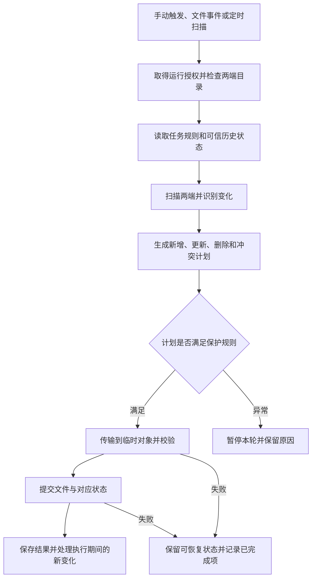

# 文件同步原理与 CWNAS 实践

文件同步要解决的是：**多个位置上的文件发生变化后，按照明确规则识别差异、传递内容，并处理覆盖、删除和冲突，使数据最终达到预期状态。** 复制字节只是其中一个步骤，判断“该复制什么、能否覆盖、什么时候算成功”同样重要。

本文查阅日期为 **2026-10-21**。主要资料包括 rsync（由调用方指定两端路径的文件传输工具）、Syncthing（由各设备运行、按共享文件夹配置同步的系统）、rclone（由部署者配置远端连接的多存储后端工具）的官方文档，以及 WebDAV（由服务端提供、客户端调用的远程资源和文件操作协议）标准与 Linux 系统接口手册。工具行为需结合实际安装版本和存储后端确认；示例与设计建议不代表 CWNAS 当前已实现能力。

项目背景：[[70-项目/01-CWNAS/01-设计文档/Sync|CWNAS 文件同步方案对比]]、[[70-项目/01-CWNAS/01-设计文档/Sync 1|带示意图的同步设计笔记]]，两份笔记的元数据日期均为 2026-09-07。网络传输背景见 [[70-项目/01-CWNAS/02-相关知识/网络穿透/00-网络穿透知识导航|网络穿透知识导航]]。

## 阅读导航

- [[#1. 同步、镜像、备份与共享分别是什么|概念入门]]：第 1～3 节，区分同步、镜像、备份并理解完整流程。
- [[#4. 如何发现文件变化|原理与正确性]]：第 4～9 节，理解变化发现、增量、基线、冲突、删除和持久化。
- [[#10. 常见工具与能力层次|工具与项目设计]]：第 10～12 节，比较方案、理解 CWNAS 分工及跨平台边界。
- [[#13. 命令示例与使用边界|实际检查]]：第 13～15 节，查看命令示例、排障和验收场景。
- [[#16. 参考资料|原始资料]]：第 16 节，正文脚注可直接定位来源。

## 1. 同步、镜像、备份与共享分别是什么

**NAS（网络附加存储）** 是用户部署在网络中的存储设备，提供文件与相关应用服务；本文以电脑、CWNAS 和网盘之间的数据流动为主要场景。

| 概念 | 由谁发起或配置 | 主要目标 | 对删除和历史的含义 |
| --- | --- | --- | --- |
| 复制 | 用户或程序指定源与目标 | 把选中的内容放到目标 | 是否覆盖由操作决定，不天然持续跟踪后续变化 |
| 单向更新 | 用户指定权威源和执行规则，同步程序运行 | 将源端新增、变化内容送到目标 | 可保留目标独有内容；仍可能覆盖同名文件 |
| 单向镜像 | 用户指定权威源，同步程序维护目标 | 让目标在纳入比较的范围内与源一致 | 可删除目标多余文件，源端误删可能传播 |
| 双向同步 | 用户授权两端修改，同步程序维护变化历史 | 将两端修改协调到一致状态 | 需解释删除、同时修改和首次合并规则 |
| 备份 | 用户定义备份对象、频率、保留与恢复策略 | 在需要时恢复某个历史状态 | 是否可恢复取决于历史保留、隔离和恢复验证 |
| 文件系统快照 | 支持快照的存储系统按管理员设置生成 | 保留某个时间点的存储视图 | 本机快照仍可能与原数据共享同一故障范围 |
| 网络共享或挂载 | 服务端发布文件，客户端通过协议访问 | 让应用操作远端存储 | 不必在每端形成完整独立副本，不自动提供离线同步 |

例如 rclone 的 `copy` 保留目标多余文件，`sync` 按源调整目标，`bisync` 处理双向变化；这些命令的语义不同。Syncthing 官方也明确提醒，同步可能传播修改和删除，不能直接当作具有完整保护策略的备份。[^S08][^S09][^S10][^S07]

**版本保留** 是保存被替换或删除的旧内容，由同步工具、存储服务或备份系统按配置执行。它不一定覆盖全部写入路径：Syncthing 的版本保留主要保护从其他设备同步过来的替换和删除，不会自动保存本机自行修改前的旧版本。[^S06]

**实时协作编辑** 是多人在同一逻辑文档上协同合并操作的能力，通常由编辑器或协作服务实现。普通文件同步看到的是文件状态，未必理解文本段落、表格单元格或应用内部记录；“同步很快”不代表能自动合并多人编辑。

## 2. 关键术语和对象

| 名称 | 是什么、由谁创建或维护 | 负责什么，与相近概念的区别 |
| --- | --- | --- |
| 同步任务 | 用户配置、管理程序保存的一组规则 | 指定两端目录、模式、过滤、冲突与调度，不等于一次执行 |
| 执行端 | 实际运行同步程序的电脑或 NAS，由任务配置确定 | 进行扫描、比较和传输；下载方向也可以由客户端主动执行 |
| 存储后端 | 同步工具连接本地文件系统、网盘或其他存储的适配实现 | 提供列目录、读写、删除等能力；不同后端能力不一致 |
| 文件元数据 | 文件系统或服务维护的大小、修改时间、类型和权限等信息 | 帮助比较和恢复属性，不等于文件内容 |
| 文件清单 | 扫描程序生成的路径及属性记录 | 表示某次观测；不天然说明过去发生过什么 |
| 索引 | 同步程序持久化的文件和版本信息 | 减少重复工作并维护已知状态；不是用户文件本身 |
| 基线 | 双向引擎保存的上次可信同步状态 | 用来判断哪一端发生了变化；不能随临时缓存任意删除 |
| 哈希/校验摘要 | 对确定内容执行算法得到的摘要，由端点计算或后端提供 | 用于比较内容或检验传输；不是加密，也不天然证明来源可信 |
| 数据块 | 算法按规则切分的内容片段，由同步引擎建立块清单 | 用来复用已有数据；与上传时按大小拆开的分片不是同一概念 |
| 冲突 | 多个变化无法按既定规则直接协调的状态，由引擎识别 | 需要保留或选择版本；不一定意味着网络或磁盘出错 |
| 删除标记 | 某些引擎记录的“此对象被删除”的版本状态 | 向离线设备传播删除事实；有时称为墓碑，不是回收站中的文件副本 |
| 提交 | 引擎确认某项操作完成并更新可信状态的过程 | 将可见内容与恢复状态关联；不等于网络发送完毕 |

这些是便于讨论的通用对象；工具不必使用同一数据结构。Syncthing 维护带版本和删除字段的文件索引，rclone bisync 通过两端清单与历史状态识别变化，二者不能直接套用同一种内部实现。[^S05][^S10]

## 3. 一轮同步如何执行

下面是便于理解和设计的抽象流程。工具可能边扫描边传输或按文件提交，但必须明确错误怎样影响本轮结果与后续状态。



建议把成功条件分开记录：

1. **扫描成功**：目标身份、目录可用性和所需列表获取正常。
2. **计划成立**：覆盖、删除和冲突遵循当前任务规则。
3. **文件完成**：内容和要求的属性已写入目标，校验满足规则。
4. **状态可恢复**：引擎保存了与已完成操作一致的记录。
5. **任务结果明确**：成功、部分失败、取消与需人工处理分别可见。

网络连通只覆盖传输前提。进程退出码成功也应结合引擎定义的检查范围解读，不能据此推导业务权限、全部历史或所有外部写入都已被验证。

## 4. 如何发现文件变化

### 4.1 周期扫描

扫描程序遍历目录，对当前文件属性与索引进行比较；需要时读取内容并计算摘要。优点是能重新校准实际状态，代价是目录遍历、元数据请求、内容读取和哈希计算。

对于百万个小文件，列目录和请求次数可能比文件内容更影响耗时；对于少量大文件，重新读盘和计算摘要可能成为主要成本。rclone 各后端的列表、时间和摘要能力不同，应分别测量。[^S11]

### 4.2 文件事件监听

**文件事件监听器** 是应用向操作系统登记、持续接收目录变化通知的组件。Linux 常用的 **inotify** 由内核提供事件接口、应用建立监视对象，报告创建、写入、重命名和删除等现象；它提供变化提示，不提供完整的同步结论。[^S15]

事件可能合并，队列可能溢出；目录递归监听和跨目录重命名也需要应用正确处理。因此建议将事件用作“这个范围需要重新检查”的提示，保留周期校准机制。Syncthing 同时使用监听与扫描，官方建议监听启用后仍保留定期扫描。[^S15][^S04]

### 4.3 合并事件而不丢变化

**防抖** 是将短时间内重复触发合并成一次工作，由调度逻辑维护；**脏状态** 是程序记录“自上次处理后又发生变化”的标记。建议按以下方式组织：

- 连续写入时合并重复触发，同时设置最大等待，防止频繁写入让任务永远不能开始。
- 运行开始时记住当前变化序号；结束时只确认处理到哪个序号，期间产生的新变化继续保留。
- 监听溢出、程序重启或目录重新挂载后，安排重新扫描，恢复对实际状态的认识。
- 同步写入自身也可能触发事件；让后续比较识别“已经一致”，不要用一段固定屏蔽时间丢弃该目录的全部外部变化。

这些是调度设计建议，不是对某个工具内部实现的描述。

## 5. 怎样判断文件相同

| 比较依据 | 成本和适用范围 | 主要边界 |
| --- | --- | --- |
| 相对路径与类型 | 识别比较对象，成本较低 | 文件同名不等于内容相同；文件和目录可能发生类型冲突 |
| 大小 | 元数据成本低 | 同样大小的两个文件可以包含完全不同的内容 |
| 修改时间 | 通常较低，可与大小组合筛选 | 时间精度、时钟和后端保存方式会影响结果 |
| 内容摘要 | 需要已有可信摘要或读取文件计算 | 需比较同一算法对同一内容范围的摘要 |
| 应用版本或条件令牌 | 由存储或业务系统提供 | 表示版本/并发条件，不能随意当作通用内容哈希 |

rsync 的默认快速检查主要比较大小和修改时间；rclone 的比较也受后端是否支持适合同步的修改时间、共同摘要算法影响。工具提供“校验和模式”不代表远端一定能低成本提供需要的哈希。[^S01][^S11]

**HTTP** 是客户端与服务器交换请求和响应的协议，由浏览器、应用和服务实现。**ETag（实体标签）** 是 HTTP/存储服务生成的表示标识，客户端可用它进行条件请求。以 Amazon S3 为例，ETag 是否等于整个对象的 MD5 摘要，取决于上传和加密方式；分段上传对象的 ETag 不能直接当作完整文件 MD5。**MD5** 是一种摘要算法名称，本段仅用于解释字段含义，不作为新身份认证方案的推荐。[^S20]

一个常见反例：A、B 两端都有 1 MiB（即 `2^20` 字节）的文件，A 在相同长度下改写内容，又保留了原修改时间。仅比较大小和时间可能漏掉变化；周期性内容校验可以补充发现能力，但会增加读取成本。

建议将“快速判断要不要传”和“传完以后内容是否正确”分别设计。两者目的不同，不能因为前者使用了元数据，就省略后者要求的校验。rsync 手册也明确区分传输前的 `--checksum` 比较与传输重建后的校验。[^S01]

## 6. 文件级增量、块级增量和断点续传

### 6.1 三种能力不能互相代替

| 能力 | 减少什么工作 | 典型情况 |
| --- | --- | --- |
| 文件级增量 | 跳过未变化文件 | 目录中 100 个文件只改 1 个，只处理变化文件 |
| 块级或字节差分 | 复用变化文件内部仍相同的部分 | 大文件小修改时，尽量少传已有数据 |
| 断点续传 | 重用中断前已接收的内容或会话状态 | 一次传输断开后尽量继续，而非全部重发 |

支持分片上传，也不自动意味着能比较远端旧文件并只上传差分。是否支持跨进程/跨连接续传，还取决于临时状态、上传协议和后端限制。

### 6.2 rsync 式差分

经典 rsync 算法中，拥有旧文件的一方把旧内容分块并发送摘要；新文件一方用 **滚动校验** 快速查找可复用片段，再用较强摘要确认匹配，最后发送“引用旧块”和“写入新内容”的指令。滚动校验是窗口移动一个字节时仍能低成本更新摘要的算法，不要求新旧内容只在原有固定偏移处匹配。[^S02][^S03]

```text
旧文件：AAAA BBBB CCCC DDDD
新文件：XXXX AAAA BBBB CCCC DDDD

直接按相同偏移比较：后面许多块都会显得不同
按内容查找可复用片段：有机会复用后面的原内容，只传插入部分及指令
```

这是说明匹配方式的抽象示例。节省量取决于块大小、内容相似度、压缩/加密格式及读盘成本；不能保证修改 4 KiB 就只产生 4 KiB 网络流量。rsync 也可以按选项或场景使用整文件传输，本地路径之间的默认行为与远程差分场景不同。[^S01]

### 6.3 Syncthing 的块复用

Syncthing 为文件建立块清单和摘要，接收端获取缺少的块，可能从本地已有文件复用，也可能从其他设备请求。它同时处理设备间文件版本和冲突，因此属于完整同步系统，而不是仅生成二进制差分的库。[^S04][^S05]

### 6.4 rclone 的能力边界

rclone 适合连接多种存储后端，常见 `copy/sync` 工作流会跳过未变化的文件，但不能据此承诺具有通用 rsync 式旧文件字节差分能力。是否支持服务端复制、分段上传、续传和某类块操作，必须查看对应后端与版本。[^S08][^S09][^S11]

**服务端复制** 是存储服务在自身系统内复制对象的能力，由后端接口提供，可能避免执行端下载再上传；它与“在已有目标文件内部打差分补丁”不是同一件事。

## 7. 双向同步为什么需要历史状态

### 7.1 只有当前文件无法判断删除还是新增

```text
当前 A：没有 report.md
当前 B：存在 report.md
```

仅凭当前状态，可能有两种解释：B 新建了文件，需要复制到 A；或者 A 删除了旧文件，需要在 B 传播删除。要区分，就需要上次可信状态或相应版本历史。rclone bisync 的历史清单正是承担这类作用；不能将双向同步理解为先从 A copy 到 B，再从 B copy 到 A。[^S10]

### 7.2 基于共同基线的概念决策表

下表描述两端都允许修改、且基线可信时的常见设计规则；它不是所有工具默认策略的逐项保证。

| A 相对基线 | B 相对基线 | 建议的处理逻辑 |
| --- | --- | --- |
| 未变化 | 未变化 | 无需传输 |
| 新建/修改 | 未变化 | 将 A 的有效变化同步到 B |
| 未变化 | 新建/修改 | 将 B 的有效变化同步到 A |
| 删除 | 未变化 | 按删除策略传播，并保留要求的恢复副本 |
| 未变化 | 删除 | 对称处理 |
| 两端变化但当前内容相同 | 两端变化但当前内容相同 | 可收敛到相同内容，更新必要状态 |
| 两端变化且内容不同 | 两端变化且内容不同 | 进入冲突规则，不仅凭时间擅自覆盖 |
| 删除 | 修改 | 识别删除与修改冲突，按明确规则保留内容或待处理 |
| 不可访问/清单不可信 | 任意状态 | 暂停依赖该清单的推断，不把错误解释为空目录 |

首次两端都有文件时，尚不存在共同基线，应先选定初始合并/覆盖策略，并检查同名异内容文件。改变同步根目录、过滤规则或比较方式，也可能改变清单含义，应走相应引擎的重新规划或初始化流程。[^S10][^S13]

### 7.3 版本向量如何识别并发

**版本向量** 是按设备记录逻辑计数的版本结构，由支持该机制的同步引擎维护，用来判断哪些修改已经包含在某个版本中。它与文件修改时间不同，不依赖把所有设备物理时钟排成同一个准确顺序。Syncthing 的块交换协议包含这类版本字段。[^S05]

假设两端原本知道的版本是 `[A:1, B:1]`：

```text
A 离线修改后：[A:2, B:1]
B 离线修改后：[A:1, B:2]

A 的计数更大，但 B 的计数更小，双方都没有包含对方的修改
因此属于并发变化，不能直接认定某一版是另一版的后继
```

若 A 已接收 B 的变化后继续修改，可能产生 `[A:2, B:2]`，它包含之前两个计数所代表的历史。这里是解释因果关系的简化示例；相同内容的收敛、冲突命名和删除取舍仍要由具体协议定义。使用 rclone 时，不应在外层再自建一套版本向量去覆盖 bisync 的内部基线规则。

## 8. 冲突与删除怎样处理

### 8.1 常见冲突策略

| 策略 | 谁决定 | 优点 | 代价与适用边界 |
| --- | --- | --- | --- |
| 保留双方版本 | 引擎按配置为冲突内容另存名称 | 尽量保留用户数据，便于人工判断 | 需要展示冲突、管理命名和清理规则 |
| 固定一端优先 | 用户明确选择权威端 | 规则可预测 | 另一端修改可能被覆盖，不适合宣称无损双向协作 |
| 按时间选择 | 引擎依据时间规则决定 | 简单，某些单向场景易理解 | 时钟和时间精度不可靠时会误选，且无法理解内容价值 |
| 暂停并人工处理 | 用户或管理员选择 | 适合重要内容和无法自动取舍的情况 | 需要可恢复的待处理状态，影响自动完成率 |
| 内容级合并 | 了解格式的应用或专用合并器处理 | 可以合并特定文本或结构化内容 | 依赖格式，仍可能产生语义冲突，不适合任意二进制文件 |

Syncthing 会生成冲突副本，但有自己关于修改与删除的规则；rclone bisync 也提供可配置的冲突处理方式。产品界面应展示实际引擎策略，而不是默认写成“智能合并，不会丢数据”。[^S04][^S10]

### 8.2 删除必须建立在可信观测上

以下状态应与“源目录真实变空”区分：磁盘没有挂载、远端返回认证失败、目录列表分页中途失败、权限收紧后看不到文件、同步根目录被误改、过滤规则刚刚变化。

建议在计划删除前验证目标身份、挂载点/存储卷、根目录、列表是否完整，以及删除数量和占比是否符合规则。**标记文件** 是部署者在同步根目录创建、供任务检查位置身份的小文件；它能增加发现错误目录的机会，却不能单独证明整个列表完整或权限未变。

删除阈值、回收站和版本保留分别解决不同问题：阈值限制本轮操作量，回收站/旧版本提供内容恢复，可信历史用于判定是否该删除。三者不能互相代替。rclone 的删除限制和 bisync 访问检查可提供部分机制，具体覆盖范围要按配置验证。[^S09][^S10]

### 8.3 离线设备与删除历史

若引擎使用删除标记，需要让较晚回来的设备知道某个文件确实被删除。过早遗忘删除历史，可能让旧副本被误认为新内容重新传播；长期保存所有历史也有资源成本。因此删除状态何时压缩、设备长期离线后如何重新加入，应按引擎协议处理，不能把索引数据库当作随时可清理的缓存。Syncthing 协议中的删除字段与版本字段共同描述文件状态。[^S05]

## 9. 怎样保证中断后内容和状态可信

### 9.1 避免用户看到半个文件

在支持相应语义的本地文件系统中，常见设计是在目标目录所在文件系统写临时文件，完成校验后，再通过重命名替换正式路径。**原子替换** 指读者看到旧对象或新对象，而不是替换过程中的半成品；它只描述特定操作的可见性，不等于多文件事务。Syncthing 采用临时文件和替换机制，Linux `rename` 手册说明了同一文件系统内相关重命名语义。[^S04][^S16]

**持久化** 指内容和目录变化已按所需保证落入可靠存储。Linux 上对文件执行 `fsync` 不自动等于目录项也已持久化；需要时还应同步相应目录，并根据文件系统和存储约束设计。`fsync` 是应用调用、由操作系统提供的数据同步接口，与“调用 write 成功”不是同一保证。[^S17]

跨文件系统重命名可能失败；云盘和 WebDAV 的移动、覆盖语义也不能默认等于本地 `rename`。WebDAV 在 HTTP 上增加远端资源属性、目录操作等能力；是否能原子替换、能保留哪些属性，需要核对服务与后端能力。[^S16][^S19][^S12]

### 9.2 内容与索引不能互相谎报

建议引擎或集成层能够区分：准备写入、部分传输、内容已校验、目标已提交、索引/基线已确认。这样重启后可以判断是继续、重试、验证还是暂停，而不是把“进程曾经启动”记为成功。

**幂等** 指对同一操作重复执行仍能得到预期结果，由操作编号、前置版本条件和状态记录等设计保证。例如重试“将已知版本的 A 更新为 B”应确认当前目标身份与版本，避免误覆盖用户在第一次失败后新增的修改。

当采用现成引擎时，按它提供的恢复机制组织外部任务状态。rclone bisync 的工作目录保存关键状态，恢复选项与 `--resync` 具有不同语义；不应在失败后自动删除工作目录，再以重新初始化掩盖原本的双向变化。[^S10]

### 9.3 活跃文件与数据库

文件可能在扫描后、读取时继续变化。对这类对象，可以采用稳定性检测、读取前后复核、应用导出或文件系统快照；所需方案取决于一致性要求。

**应用一致性** 指备份或同步出的内容符合应用内部状态，例如数据库的数据页和日志相互匹配。它与某一个文件成功复制不同。以 SQLite 为例，官方提供在线备份接口与 `VACUUM INTO` 等方式获取运行中数据库的副本；不能假设逐个同步数据库主文件和日志就能获得一致数据库。[^S18]

对于虚拟机磁盘、邮件库等持续变化的大文件，也应先明确应用或存储的一致性机制，再评估增量传输。差分算法只能减少数据搬运，不能修复不一致的源视图。

## 10. 常见工具与能力层次

| 工具或组件 | 是什么、由谁配置 | 适合的主要场景 | 集成时要补充或核对什么 |
| --- | --- | --- | --- |
| rsync | 命令行文件传输工具，由调用方指定源、目标和选项 | 两个目录间传输、单向更新、镜像与远程增量 | 双向历史、长期调度、冲突体验；实际传输方式及权限属性 |
| Syncthing | 多设备文件夹同步系统，由各设备运行服务并共享文件夹 | 电脑与 NAS、设备之间持续同步 | 设备加入和权限、文件夹模式、冲突、版本保留、资源使用 |
| rclone | 多存储后端的命令行工具，由部署者配置 remote 和任务命令 | NAS 与网盘、对象存储、WebDAV，以及周期同步 | 后端能力、bisync 状态、授权、调度和产品界面 |
| `fast_rsync` 等差分库 | 开发者在程序中调用的差分计算组件 | 自研同步产品中的块复用和字节传输优化 | 文件发现、版本、冲突、删除、传输协议、任务与恢复 |

**remote** 是 rclone 配置中命名的远端连接，由用户或产品配置后端类型、访问地址和凭据；`nas-demo:docs` 表示名为 `nas-demo` 的远端中的路径 `docs`，不是通用网络 URL。**对象存储** 是按对象名称和接口读写数据的存储服务，由服务提供方维护；它未必具备本地目录、权限和原子改名的完整语义。[^S11]

rsync 的工具行为见官方手册，Syncthing 的持续同步机制见其同步说明，rclone 的命令和后端能力见对应页面。`fast_rsync` 的文档说明其签名、差分与恢复字节能力；仅接入库不能替代完整同步系统。[^S01][^S04][^S08][^S09][^S10][^S21]

选型建议：两端都是可控设备、需要多设备持续同步时优先评估完整设备同步系统；连接大量异构云盘时优先评估多后端工具；仅需要可控方向的目录传输时评估 rsync；只有在产品确实需要自定义协议和规则时，再考虑自研差分层。

## 11. CWNAS 的设计参考

### 11.1 既有材料提供了什么背景

[[70-项目/01-CWNAS/01-设计文档/Sync|现有同步设计笔记]]提出由 CWNAS 管理权限、任务、调度及状态，由 rclone 负责比较与传输；客户端任务在电脑运行，网盘任务在 NAS 运行。[[70-项目/01-CWNAS/01-设计文档/Sync 1|另一份带图笔记]]进一步描述客户端本地 WebDAV 转发入口，用来衔接穿透传输。

这些内容是本次读取的设计记录。本文没有重新检查项目源码、安装版本或运行服务，因此不据此判断 WebDAV、目录授权、变化通知或恢复能力目前已交付。

### 11.2 设计中的对象和分工

| 对象 | 谁创建或配置 | 建议负责的范围 | 不应混同的职责 |
| --- | --- | --- | --- |
| 任务管理 | CWNAS 按用户设置创建 | 端点、目录、模式、过滤、执行位置、历史 | 不是第二个文件差异引擎 |
| 调度器 | CWNAS 创建并维护 | 合并触发、控制并发、安排重试和重新扫描 | 收到通知不等于已知道全部变化 |
| 执行器 | 在电脑或 NAS 运行的任务控制逻辑 | 启动引擎、收集进度、取消、保存结果 | 不应随意篡改引擎内部状态 |
| 受限 WebDAV 服务 | NAS 按身份和目录权限提供 | 列出及读写授权资源，执行配额与文件服务规则 | 网络可达不等于目录可写 |
| 本地转发入口 | 客户端按任务运行的本地服务 | 让 rclone 使用普通 HTTP/WebDAV 请求进入既有传输 | 不是云盘账号，也不应额外获得全盘权限 |
| 运行授权 | CWNAS 为执行轮次维护的许可 | 防止同一任务或重叠目录上的不兼容执行并发写入 | 单机进程锁不能自动覆盖其他设备 |
| 引擎工作目录 | 对应引擎在执行端维护 | 保存每任务独立的双向历史和恢复状态 | 不是可随时删除的日志目录 |

**配额** 是管理员为用户或目录配置的资源上限，由文件服务检查；**文件索引** 是 NAS 为检索和管理建立的文件记录，与同步引擎自己的历史索引不是同一个数据库。通过受控文件接口写入，有助于统一权限和索引维护，但增加的请求与数据搬运成本也应测量。

### 11.3 客户端与 NAS 的数据路径

下面是结合既有笔记整理的逻辑示意，具体实现仍需核查。


客户端即使执行“NAS → 电脑”的下载，也可以由电脑上的 rclone 主动发起请求，不需要公网服务器主动连接电脑的某个文件端口。穿透层负责让请求到达 NAS；同步层仍要处理文件比较、冲突、失败和恢复。

网盘任务则可在 NAS 执行，由 NAS 上的 rclone 连接本机受限文件入口和云盘后端；客户端电脑离线不应影响此类任务。是否需要绕经本机 WebDAV，应根据权限/索引一致性要求和性能实测确定。

### 11.4 任务边界和扩展性

建议一个任务只有一个明确执行端、一份对应引擎状态和可关联的运行编号；调整执行位置时按迁移规则处理状态，不能让两端各自维护不同基线却同时写同一组目录。

**租约** 是有期限的运行许可，由协调端签发或维护、执行端定期续期。若使用租约控制分布式任务，授权过期后还需要由实际写入入口拒绝旧执行者继续操作；仅将数据库里的任务状态改成“已停止”，不能阻止旧进程继续写入。该方案属于设计建议，不能据此断言项目已具备相应写入检查。

扩展网盘或更换引擎时，建议分别记录后端是否支持稳定列表、修改时间、共同哈希、移动/重命名、原子替换、断点续传及可恢复删除，再决定产品允许哪些同步模式，而不是所有后端统一承诺相同能力。

## 12. 跨平台、路径和元数据边界

| 问题 | 为什么影响同步 | 应先明确的规则 |
| --- | --- | --- |
| 大小写敏感性不同 | `Report.txt` 与 `report.txt` 在两端可能不是同一组可共存文件 | 冲突检测、拒绝或可逆映射，不静默覆盖 |
| Unicode 表示形式不同 | 视觉相同的名字可能有不同编码形式 | 比较与规范化策略，保存必要原名 |
| 系统保留名称和非法字符 | 某端无法直接创建另一个端的文件名 | 记录不可表示错误，或使用可逆编码 |
| 符号链接 | 路径可指向同步根目录以外 | 复制链接、跟随链接或拒绝的明确策略 |
| 权限、ACL、扩展属性 | 后端对属性支持不同 | 定义必须保留和允许丢失的属性 |
| 重命名与目录移动 | 有的后端需要复制再删除 | 核对成本、并发修改和失败恢复 |
| 超长路径与文件类型变化 | 名称能列出但未必能创建或替换 | 明确失败结果，不将部分失败标作全部成功 |

**ACL（访问控制列表）** 是文件系统或服务由管理员维护的细粒度权限记录，区别于简单的文件读写位；**扩展属性** 是某些文件系统允许附加在文件上的元数据。是否跨后端保留这些属性，要按引擎选项和协议能力验证。rsync 的归档选项也不自动涵盖所有 ACL、扩展属性和硬链接保留能力。[^S01]

Syncthing 官方列出了大小写、元数据及平台差异限制；WebDAV 对资源和属性提供协议定义，不保证每一种本地文件属性都可无损映射。[^S04][^S07][^S19]

接收端应将远端名字解释为授权根目录下的相对路径，校验实际访问位置和链接行为。这里的 **根目录约束** 是文件服务决定任务可访问范围的规则，不应只依赖字符串前缀判断。

## 13. 命令示例与使用边界

本节是便于理解工具语义的示例，**本次整理未执行任何同步命令**。`./sync-demo/source/`、`./sync-demo/target/` 和 `nas-demo:docs` 都是演示位置；实际使用需先确认内容、方向、权限和远端配置。

### 13.1 rsync：预览更新与镜像

```bash
# 预览：更新目标，保留目标多余文件。
rsync -an --itemize-changes ./sync-demo/source/ ./sync-demo/target/

# 预览：增加删除目标多余内容的镜像语义。
rsync -an --delete --itemize-changes ./sync-demo/source/ ./sync-demo/target/
```

`-n` 是预演，不执行实际文件修改；`-a` 是归档模式，组合了常见递归和属性处理选项；`--itemize-changes` 列出拟发生的变化。源目录末尾的 `/` 表示处理目录内容，省略时路径结果可能不同。即使使用归档模式，也要根据需求另行确认 ACL、扩展属性等选项。[^S01]

### 13.2 rclone：预览单向更新与镜像

```bash
# 预览：保留远端中本地没有的文件。
rclone copy ./sync-demo/source nas-demo:docs --dry-run

# 预览：让远端在任务范围内按本地目录同步，计划可能包含删除。
rclone sync ./sync-demo/source nas-demo:docs --dry-run
```

`--dry-run` 用于预演；命令仍需读取相应配置、访问端点和生成计划，不是无需凭据的离线语法检查。rclone 的目录参数语义也不要直接按 rsync 的末尾 `/` 规则推断。过滤、跳过已有文件及删除选项会改变实际计划，命令名本身不是完整策略。[^S08][^S09][^S13]

### 13.3 为什么不提供“一键 bisync 初始化”

`bisync` 首次运行需要建立状态，`--resync` 可用于重新同步/初始化，但它与普通运行具有不同的合并含义。初始化前需要明确两端已有文件如何取舍、状态目录放在哪里、是否有历史副本，以及当前版本的冲突策略。失败后自动追加 `--resync` 可能掩盖删除或覆盖的原始意图。[^S10]

因此，集成设计应将“建立初始基线”“正常双向同步”“中断恢复”“重新初始化”设为可区分的操作，记录用户选择及预览结果；恢复选项仍应按所用版本单独验证。

### 13.4 内容校验

```bash
# 只检查差异；可能产生远端列表、读取或摘要请求。
rclone check ./sync-demo/source nas-demo:docs
```

`check` 不复制文件，使用两端支持的大小和摘要能力检查差异。没有共同摘要时，不应把普通检查结果解释为所有文件内容都经过完整读取校验；如需下载读取验证，官方提供 `--download` 等方式，但会产生额外读盘和网络成本。额外文件是否算差异，也要根据是否启用单向检查等选项解释。[^S14]

## 14. 故障排查与性能观察

### 14.1 按阶段排查

| 现象 | 优先检查 | 需要避免的误判 |
| --- | --- | --- |
| 完全没有执行 | 调度、执行端在线、锁或运行授权、禁用状态 | 文件没有变化 |
| 扫描看不到文件 | 目录身份、权限、挂载、过滤和列表分页错误 | 源目录确实为空 |
| 修改后没有传输 | 比较依据、时间精度、事件是否丢失、是否需要重新扫描 | 监听事件成功就表示同步完成 |
| 每轮都重复传同一文件 | 修改时间保存、共同摘要、目标属性回写、外部程序持续写入 | 网络速度慢 |
| 大文件从头重传 | 后端续传能力、临时状态、内容版本、进程恢复方式 | 所有“增量工具”都支持续传 |
| 大量冲突 | 同时编辑、共同历史、路径映射、时间策略、多个执行者 | 多半是普通网络抖动 |
| 删除数量突然变大 | 根目录、挂载、列表完整性、过滤变更及基线 | 直接放宽删除阈值即可 |
| 数据到了但界面没变 | 文件服务提交、索引维护、任务结果上报 | 再复制一遍一定能解决 |
| 任务结束但状态不可信 | 部分失败项、校验范围、提交与恢复记录 | 进程退出就代表全部业务成功 |

该表是依据前文机制推导的诊断顺序，不是本次现场测试结论。

### 14.2 建议记录的观测项

- **扫描**：目录和文件数、列表耗时、元数据请求数、读取及哈希耗时。
- **计划**：新增、更新、删除、冲突与跳过数量，预计传输内容量。
- **传输**：实际收发字节、传输耗时、重试、限流、内容与属性失败。
- **提交**：临时对象、替换结果、状态保存、取消后的资源回收。
- **业务**：任务编号、运行编号、执行端、目标设备、规则版本与最终结果。

注意把三个数分开：用户文件大小、实际读取内容量、网络传输量。块复用可能少传但仍大量读盘；压缩可能降低网络量但增加处理耗时；服务端复制可能减少执行端流量却仍产生存储 API 请求。**API** 是服务暴露给程序调用的接口，由服务端实现、客户端请求；请求数可能受到后端速率和计费规则约束。[^S01][^S11]

### 14.3 如何评价一个方案

建议分别使用“少量大文件”“大量小文件”“大文件局部修改”“长时间离线后重连”四类数据集，测量首轮、无变化轮、变化轮和失败恢复轮。记录路径、工具版本、后端、并发与比较参数，避免把不同语义下的速度直接比较。

总耗时可以按观察目的拆为：准备与列表、读取/摘要、传输、目标写入、校验、提交。各步骤可能并行，不能把统计项简单相加当作真实墙钟时间；应同时记录开始结束时间和阶段跨度。

## 15. 建议的最小验收场景

以下是后续实现或部署时可用的验证清单，本次没有运行项目测试或实际同步。

| 场景 | 至少验证什么 |
| --- | --- |
| 首次两端都有数据 | 同名同内容、同名异内容、各端独有文件按初始规则处理 |
| 单端新增和修改 | 正确方向传输，内容与约定属性一致 |
| 两端离线修改同一文件 | 冲突可发现，保留或取舍符合明确策略 |
| 一端删、另一端改 | 按冲突规则处理，不无意丢失修改 |
| 文件与目录重命名 | 目标结果正确，失败中断可恢复，重复名称不误覆盖 |
| 磁盘卸载或权限失效 | 任务识别错误，不把不完整视图当作删除依据 |
| 传输中断、进程退出、重启 | 临时文件、已完成项与历史状态可解释，按引擎恢复 |
| 运行期间又发生变化 | 新变化被保留并在适当轮次处理 |
| 监听溢出或漏事件 | 重新扫描能恢复正确识别 |
| 大小写、特殊名字、链接和属性 | 支持范围清楚，无法表示的对象明确报错 |
| 取消和重复触发 | 不产生失控并行执行，旧执行者不能继续越权写入 |
| 删除阈值及历史恢复 | 异常删除被拦截，保留内容可实际恢复 |
| 正常完成后再运行 | 无意外重复写入，比较和状态进入稳定状态 |

同步验收应检查源和目标的实际文件结果，以及冲突、删除和恢复后的内容，不能只检查进度达到 100%。历史版本能列出也不等于能恢复，应实际取回并验证内容。

## 16. 参考资料

以下均于 **2026-10-21** 查阅。网址使用行内代码保留，便于复制；脚注中的章节提示用于快速定位原文。未固定版本的官方文档会继续更新，实施时应对照部署版本。

[^S01]: rsync 官方手册。`https://download.samba.org/pub/rsync/rsync.1`。重点：快速比较、差分传输、`--checksum`、`--dry-run`、目录末尾斜线、删除、归档及属性选项。

[^S02]: Andrew Tridgell / Paul Mackerras，The rsync algorithm，算法说明。`https://rsync.samba.org/tech_report/node2.html`。重点：旧块签名、匹配、复用与增量传输。

[^S03]: rsync 技术报告，Rolling checksum。`https://rsync.samba.org/tech_report/node3.html`。重点：滚动窗口校验如何减少匹配成本；它与最终内容确认使用的摘要职责不同。

[^S04]: Syncthing 官方文档，Understanding Synchronization。`https://docs.syncthing.net/users/syncing.html`。重点：扫描、监听、块传输、临时文件、冲突及平台限制。

[^S05]: Syncthing，Block Exchange Protocol v1。`https://docs.syncthing.net/specs/bep-v1.html`。重点：文件信息、块、删除字段及版本向量。它是 Syncthing 的协议定义，不是所有同步工具通用的内部模型。

[^S06]: Syncthing，File Versioning。`https://docs.syncthing.net/users/versioning.html`。重点：远端同步引起的替换/删除如何进入版本保留，以及本机修改的边界。

[^S07]: Syncthing，Frequently Asked Questions。`https://docs.syncthing.net/users/faq.html`。重点：同步与备份的关系，以及 Syncthing 的用途边界。

[^S08]: rclone copy 官方文档。`https://rclone.org/commands/rclone_copy/`。重点：复制更新而保留目标多余文件；目录参数和预演语义。

[^S09]: rclone sync 官方文档。`https://rclone.org/commands/rclone_sync/`。重点：按源调整目标、删除、过滤和预演；结合全局选项理解删除限制。

[^S10]: rclone bisync 官方文档。`https://rclone.org/bisync/`。重点：双向历史、工作目录、初始化/重新同步、访问检查、冲突、中断恢复。恢复参数及默认行为须按安装版本核对。

[^S11]: rclone 后端能力概览与通用使用说明。`https://rclone.org/overview/`、`https://rclone.org/docs/`。重点：共同摘要、修改时间、服务端复制、存储能力及执行参数；同一工具不同后端可能表现不同。

[^S12]: rclone WebDAV 后端官方说明。`https://rclone.org/webdav/`。重点：不同 WebDAV 服务的摘要、修改时间和能力差异。接入 WebDAV 并不自动具有全部本地文件系统语义。

[^S13]: rclone Filtering。`https://rclone.org/filtering/`。重点：纳入/排除规则及删除相关边界；调整过滤需要结合历史状态和实际计划评估。

[^S14]: rclone check 官方文档。`https://rclone.org/commands/rclone_check/`。重点：大小/摘要检查、无共同摘要时的能力边界、`--download` 和单向检查。

[^S15]: Linux inotify(7) 手册。`https://man7.org/linux/man-pages/man7/inotify.7.html`。重点：事件合并、队列溢出、非递归监视和重命名事件处理。man7 提供 Linux 系统接口手册的可浏览版本。

[^S16]: Linux rename(2) 手册。`https://man7.org/linux/man-pages/man2/rename.2.html`。重点：原子替换、文件系统边界和错误条件。

[^S17]: Linux fsync(2) 手册。`https://man7.org/linux/man-pages/man2/fsync.2.html`。重点：文件内容、目录项持久化及错误；原子可见性与断电后持久性是不同维度。

[^S18]: SQLite，Online Backup API。`https://www.sqlite.org/backup.html`。重点：运行中数据库的一致副本、在线备份接口及其他备份方式。

[^S19]: RFC 4918，HTTP Extensions for Web Distributed Authoring and Versioning (WebDAV)。`https://www.rfc-editor.org/rfc/rfc4918.html`。由 IETF 制定、RFC Editor 发布的标准轨文档；重点：资源、集合、属性、COPY/MOVE 及条件请求。

[^S20]: Amazon S3 API，Object 数据类型与 ETag 说明。`https://docs.aws.amazon.com/AmazonS3/latest/API/API_Object.html`。重点：ETag 与 MD5 的条件关系，分段上传及加密方式的影响。

[^S21]: fast_rsync 官方 crate 文档。`https://docs.rs/fast_rsync/latest/fast_rsync/`。重点：签名、差分和恢复字节的库接口；`latest` 是可变文档入口，不表示 CWNAS 依赖该版本。
