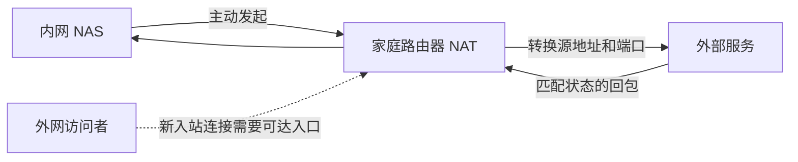

# 网络基础与穿透全景

返回 [[70-项目/01-CWNAS/02-相关知识/网络穿透/00-网络穿透知识导航|知识导航]]。

## 1. 先认识数据经过的对象

IPv4 和 IPv6 是互联网寻址协议的两个版本，由设备系统和网络共同支持；它们使用不同的地址格式。局域网是家庭、办公室等范围内由本地设备和网关组成的网络；公网在本文中指可跨互联网路由访问的网络范围，不能只凭地址显示在网卡上就认定可从外部访问。

| 名称 | 是什么、由谁创建或配置 | 负责什么，以及容易混淆的地方 |
| --- | --- | --- |
| IP 地址 | 分配给网络接口的地址，由网络管理员、运营商或自动配置机制分配 | 用于寻址；一台 NAS 可以有多个接口和地址，地址不等于设备长期身份 |
| 端口 | TCP/UDP 协议中区分通信端点的编号，由应用绑定或操作系统分配 | 区分同一地址上的服务；TCP 端口与同号 UDP 端口是不同对象 |
| TCP | 由两端操作系统或协议库实现的可靠、有序字节流协议 | 提供连接及重传；不会自动赋予内网服务公网入口 |
| UDP | 由操作系统或协议库实现的数据报协议 | 保留报文边界，本身不保证交付、顺序和重传；上层可以实现可靠性 |
| socket | 应用通过操作系统接口创建的网络通信对象，可理解为程序收发数据的入口 | 通常与协议、本地地址和端口有关；不是实体网口，也不是一个完整业务用户 |
| 路由 | 由系统、路由器和管理员维护的“到某个目标从哪里走”的规则 | 决定下一跳与出口；有地址仍可能没有可用路由 |
| NAT | 网络地址转换，由路由器、运营商网关等设备执行 | 改写地址，有时也改写端口；不同于决定放行或拒绝的防火墙 |
| NAPT | 同时转换地址和端口的 NAT，通常由家庭路由器执行 | 让多台内网设备共享一个公网 IPv4；日常所说的家用 NAT 多指此类 |
| 防火墙 | 由主机、路由器或云平台管理员设置的流量控制机制 | 按方向、协议、地址、端口和状态放行或丢弃；公网 IP 也会被它拦住 |
| DNS / DDNS | DNS 将域名解析为记录；DDNS 由客户端在地址变化时更新相关记录 | 解决“域名对应什么地址”；不会创建 NAT 映射，也不自动放行端口 |
| HTTP / HTTPS | 浏览器、应用和 Web 服务实现的请求响应协议；HTTPS 使用安全传输保护 HTTP | 承载网页和接口请求；与 TCP/UDP 的传输职责不同 |
| WebSocket | 浏览器/客户端向支持的服务器建立的持续双向消息连接 | 常用于信令；连接到平台不代表已和 NAS 建立业务数据通道 |

NAT/NAPT 的术语依据 RFC 2663；UDP 和 TCP 的 NAT 行为分别见 RFC 4787、RFC 5382。下文用这些对象组成具体示例。[^S03][^S04][^S06]

## 2. 为什么 NAS 能上网，外网却连不进来

以下地址仅用于文档示例：NAS 位于 `192.168.1.10`，家庭路由器外侧地址为 `198.51.100.20`，外部服务地址为 `203.0.113.80`。

```text
NAS 发出 UDP 数据：
192.168.1.10:53000 → 203.0.113.80:3478

家庭路由器转换后：
198.51.100.20:41000 → 203.0.113.80:3478

路由器记录一条映射：
UDP 192.168.1.10:53000 ↔ 198.51.100.20:41000
```

外部服务的回包到达 `198.51.100.20:41000` 时，路由器可以按照已有映射和过滤规则转回 NAS。一个外部用户突然访问 `198.51.100.20:8080`，如果没有对应映射和允许规则，路由器通常不能把它交给 NAS 的 `8080` 服务。**允许某条出站通信的返回流量，不等于开放任意外部主动入站。**[^S03][^S04]



## 3. 哪些地址不能直接当作公网入口

| 地址范围 | 用途 | 对远程访问的含义 |
| --- | --- | --- |
| `10.0.0.0/8` | RFC 1918 私有 IPv4 | 不作为全球互联网直接路由的目标 |
| `172.16.0.0/12` | RFC 1918 私有 IPv4，即 `172.16` 到 `172.31` | 不能把所有 `172.*` 都认作私网 |
| `192.168.0.0/16` | RFC 1918 私有 IPv4 | 常用于家庭或办公局域网 |
| `100.64.0.0/10` | 运营商共享地址空间，即 `100.64` 到 `100.127` | 常用于运营商级 NAT；不是 RFC 1918 私网，也不是用户独占公网入口 |

私网范围见 RFC 1918，共享地址空间见 RFC 6598。其他特殊用途地址也不一定可在公网路由，因此“没有落在这四类里”仍不足以证明地址可入站。[^S01][^S02]

**运营商级 NAT（CGNAT）** 是运营商在用户路由器之外再次做的地址转换，由运营商维护。它与用户自己家里的 NAT 可能同时存在：

```text
NAS → 家庭路由器 → 运营商 NAT → Internet
```

在这种情况下，只配置家庭路由器端口转发通常无法解决运营商入口问题。是否存在上游转换，需要结合路由器外网口地址、外部观测地址和运营商网络信息判断；浏览器查出的出口 IP 只说明这次请求使用了哪个出口。[^S02][^S07]

## 4. 四条主要路线

| 路线 | 由谁建立入口或连接 | 实际业务数据经过哪里 | 前提或代价 |
| --- | --- | --- | --- |
| 公网直达与端口转发 | 管理员配置地址、防火墙和网关映射 | 访问端到 NAS，中间经过普通路由/NAT | 需要真正可达的地址及入站规则 |
| 协调打洞 | 两端应用配合发现服务，主动向对方发送探测 | 成功后端到端传输 | 取决于双方映射、过滤和网络策略 |
| 反向隧道或中继 | NAS 主动连接公网服务器，服务器接收访问或转发 | 业务数据经过公网服务器 | 消耗中继带宽和连接资源 |
| 虚拟组网 | 客户端创建虚拟网络接口和路由，由管理系统分配身份与策略 | 底层可直连，也可能中继 | 需要相应客户端或网关，需管理网络访问范围 |

这些路线可以组合。例如虚拟组网内部使用打洞和中继；面向浏览器的产品可以提供 HTTPS 入口，同时通过 WebRTC 建立文件传输通道。路线区分依据是“入口怎样建立、业务实际怎样走”，不是是否使用了某个产品名称。[^S07][^S25][^S27]

## 5. 端口映射和自动映射

**端口映射** 是管理员让网关把外侧某个协议和端口转发到指定内侧地址与端口。例如 `TCP 外侧:10443 → 192.168.1.10:443`。它可以长期保留，和应用临时出站形成的映射不是同一种配置方式。[^S03]

**PCP（端口控制协议）** 由内网客户端向支持该协议的网关请求映射或防火墙放行，客户端和网关软件分别实现协议。**UPnP IGD** 是通用即插即用体系中用于控制互联网网关的机制，**NAT-PMP** 是另一种 NAT 端口映射协议；都需要内网客户端与相应网关配合，不是 STUN 地址发现。即使有自动映射能力，也必须检查请求实际到达了哪层网关、返回的地址是否可达、租期如何刷新，不能推断任意上游运营商 NAT 都可由用户控制。[^S09]

## 6. IPv6 如何改变问题

IPv6 可能让 NAS 获得全球单播地址，减少对 IPv4 地址转换的依赖。家庭 IPv6 网关仍可能按连接状态限制外部主动入站；主机防火墙、服务监听地址、运营商策略和访问端的 IPv6 能力仍会影响可达性。**“有 IPv6 地址”只能作为排查起点。**[^S08][^S16]

工程上分别检查四件事：NAS 是否有可用 IPv6 路由；服务是否监听 IPv6；网关和主机是否允许目标流量；访问端是否有兼容的网络路径。双栈是同时支持 IPv4 和 IPv6，由操作系统、网络和应用共同配置；它不意味着两个地址族中的任意地址都能直接互通。[^S08][^S16]

下一篇：[[70-项目/01-CWNAS/02-相关知识/网络穿透/02-NAT行为与打洞原理]]。

[^S01]: [[70-项目/01-CWNAS/02-相关知识/网络穿透/08-参考资料#S01|S01：RFC 1918]]。
[^S02]: [[70-项目/01-CWNAS/02-相关知识/网络穿透/08-参考资料#S02|S02：RFC 6598]]。
[^S03]: [[70-项目/01-CWNAS/02-相关知识/网络穿透/08-参考资料#S03|S03：RFC 2663]]。
[^S04]: [[70-项目/01-CWNAS/02-相关知识/网络穿透/08-参考资料#S04|S04：RFC 4787]]。
[^S06]: [[70-项目/01-CWNAS/02-相关知识/网络穿透/08-参考资料#S06|S06：RFC 5382]]。
[^S07]: [[70-项目/01-CWNAS/02-相关知识/网络穿透/08-参考资料#S07|S07：RFC 5128]]。
[^S08]: [[70-项目/01-CWNAS/02-相关知识/网络穿透/08-参考资料#S08|S08：RFC 6092]]。
[^S09]: [[70-项目/01-CWNAS/02-相关知识/网络穿透/08-参考资料#S09|S09：RFC 6887]]。
[^S16]: [[70-项目/01-CWNAS/02-相关知识/网络穿透/08-参考资料#S16|S16：RFC 8835]]。
[^S25]: [[70-项目/01-CWNAS/02-相关知识/网络穿透/08-参考资料#S25|S25：Tailscale 连接类型]]。
[^S27]: [[70-项目/01-CWNAS/02-相关知识/网络穿透/08-参考资料#S27|S27：Cloudflare Tunnel]]。
