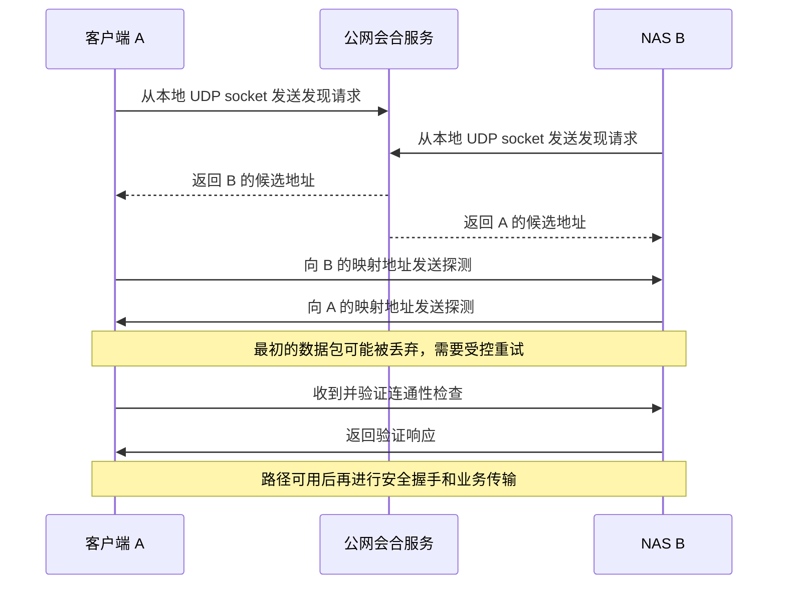

# NAT 行为与打洞原理

返回 [[70-项目/01-CWNAS/02-相关知识/网络穿透/00-网络穿透知识导航|知识导航]]。地址和端口基础见 [[70-项目/01-CWNAS/02-相关知识/网络穿透/01-网络基础与穿透全景]]。

## 1. 把“映射”和“过滤”分开

**映射（Mapping）** 是 NAT 为内网通信分配外侧地址与端口的行为，由网关根据流量及配置产生。它回答“我向外发送时，别人看到的源地址和端口是什么”。

**过滤（Filtering）** 是网关决定哪些外部来源可以经已有映射送入数据的行为，由网关规则和通信历史决定。它回答“谁可以给这个映射发包”。两者是不同维度：外部端口不变，不代表任意来源都能发进来。[^S04]

以下表格只讨论同一个协议、同一个仍有效的内网 socket，不能拿两个随机分配的内网端口直接比较。

| 映射行为 | 通俗含义 | 简写 |
| --- | --- | --- |
| 端点无关映射 | 同一个内网地址和端口访问不同外部目标，复用映射 | EIM |
| 地址相关映射 | 外部目标 IP 相同时复用映射，换目标 IP 可能换映射 | ADM |
| 地址和端口相关映射 | 外部目标 IP 或端口变化时，可能分配另一映射 | APDM |

这里的“端点”是网络地址和端口组成的通信位置，不是用户账号，也不是设备证书。简写来自英文名称，实际排障优先写清中文含义。[^S04]

| 过滤行为 | 哪些外部来源可经映射进入 |
| --- | --- |
| 端点无关过滤 | 不以外部来源 IP/端口作为这条映射的过滤限制 |
| 地址相关过滤 | 内网端曾向某个外部 IP 发包，才允许该 IP 的流量进入 |
| 地址和端口相关过滤 | 内网端曾向某个外部 IP:端口发包，才允许相应来源进入 |

这些是描述模型；设备在端口冲突、资源压力和不同协议下还可能有额外行为。RFC 7857 对早期 NAT 行为要求作了更新，标准要求也不能替代对实际设备的观测。[^S04][^S05]

## 2. 为什么不只使用 NAT1/NAT2/NAT3/NAT4

“完全锥形、受限锥形、端口受限锥形、对称型”是常见的历史分类；其中“锥形”是对外部映射和可接收来源的形象化称呼。它们将多个行为合在一个标签里，表达能力有限。不同测试工具所说的 NAT1～NAT4 也未必具有完全相同的定义。[^S04]

对于 CWNAS 的设计和问题记录，建议保存：测试协议、本地 socket、外部观察点、不同目标看到的映射、过滤现象、测试时刻及网络拓扑。可以保留工具给出的 NAT 标签，但不要只凭标签承诺固定穿透成功率。

## 3. UDP 打洞究竟做了什么

**UDP 打洞** 是两端程序主动发送 UDP 探测，让各自 NAT 产生或允许相应状态，再尝试通过这些状态互通的技术。由客户端协议实现协调，不是在路由器上永久开放一个任意人都能用的洞。**会合服务** 是两端都能连接的公网服务，由产品运营方部署，帮助交换观测地址和协商消息。[^S07]

假设 A 和 B 的 NAT 具有可复用的映射行为，且过滤规则可被向目标发送流量满足：

```text
A 内网地址：192.168.1.10:50000
A 对外映射：198.51.100.10:41000

B 内网地址：192.168.2.20:50000
B 对外映射：203.0.113.20:42000
```



这是解释原理的简化流程；实际 ICE 还需要候选优先级、认证检查和路径提名，见第 03 篇。所谓“双向打洞”不要求双方在物理上的同一微秒发包，而是需要有效时间内的映射和过滤状态配合。[^S07][^S11]

### 3.1 为什么要关注 socket 的一致性

若发现地址时使用本地 `50000`，向对端探测时换成本地 `50001`，网关就可能创建另一条映射。先前向会合服务发现的外侧端口可能与业务路径无关。因此，发现、检查和传输需要按协议正确复用或管理传输资源，不能随意新建 socket 后沿用旧地址。[^S07]

### 3.2 为什么“STUN 测出了公网地址”仍会失败

STUN 服务看到的是“发往这个服务的这次流量”的外侧地址。若 NAT 按目的地址或端口分配映射，A 发往 B 时可能使用另一外侧端口，B 拿到的观测结果就不足以指导直连。直连还依赖 B 的过滤行为及实际路由。[^S04][^S10]

不能反过来断言“出现某种映射行为就绝对不能直连”：对端有公网入口、过滤较宽松、协议发现了新的映射等情况都可能改变结果。以经过认证的连通性检查成功为准。[^S07][^S11]

## 4. TCP 也能打洞吗

可以存在 TCP 打洞方案。TCP 需要处理握手与连接状态；其中 **同时打开（Simultaneous Open）** 指双方都主动发送建立连接的 SYN 报文，并由协议栈处理相互到达的握手。它需要操作系统接口、端口复用、NAT 状态机等条件共同支持，复杂度高于简单的 UDP 探测。[^S06][^S07]

产品名称容易误导：某工具的“TCP 服务穿透”可能只是把本地 TCP 服务的数据封装进另一传输，不能据此判断它对公网执行了 TCP 打洞。应分开记录“本地服务协议”和“跨公网传输协议”。

## 5. 映射生命周期与回环

**保活（Keepalive）** 是协议或客户端周期性发送的小消息，用来维持网关状态或检测路径。**存活检测** 则关注对端是否有响应，两者目的可以重叠，但一次无响应的发包不能证明对端在线。协议自身可能已经提供相关机制，应用再叠加固定高频心跳前，应先明确需要维持哪层状态。[^S04][^S18]

不要把某篇教程的“每 30 秒发送一次”作为全部网络通用值。网关超时、移动端耗电和协议刷新机制都有差别；例如 WireGuard 官方将 25 秒描述为其持久保活的一个常用间隔，并不表示所有穿透协议都应照搬。[^S24]

**NAT 回环（Hairpinning）** 是同一 NAT 后面的两台设备，通过网关的外侧映射地址互相通信的能力，由网关实现。它与普通内网直连不同。外网能访问但内网不能用同一公网地址访问，可能与回环支持有关，也可能与 DNS 或防火墙有关，需要分层验证。[^S04]

## 6. 影响成功率的组合因素

| 因素 | 可能造成的现象 | 应记录的证据 |
| --- | --- | --- |
| 双重或多层 NAT | 某一层映射/过滤阻止探测 | 两端拓扑、外网口地址、外部观测地址 |
| 目的相关映射 | 对发现服务器和对端使用不同映射 | 同一 socket 发往不同目标的观测 |
| UDP 被网络策略拦截 | 收不到探测或回包 | 两端抓包、网关策略及 TCP/TLS 中继对照 |
| 状态过期 | 空闲后失联，重新发起后恢复 | 空闲时长、保活、映射及会话日志 |
| 网络切换 | 旧候选失效 | 网络切换时间、选中路径变化和重建记录 |
| 同一网关回环限制 | 同局域网用公网入口失败 | 内网地址、公网入口和外网测试的对照 |

该表是依据 NAT 行为和 P2P 方法推导的排查清单，不是对某个运营商网络的结论。[^S04][^S07]

下一篇：[[70-项目/01-CWNAS/02-相关知识/网络穿透/03-STUN-ICE-TURN原理与流程]]。

[^S04]: [[70-项目/01-CWNAS/02-相关知识/网络穿透/08-参考资料#S04|S04：RFC 4787]]。
[^S05]: [[70-项目/01-CWNAS/02-相关知识/网络穿透/08-参考资料#S05|S05：RFC 7857]]。
[^S06]: [[70-项目/01-CWNAS/02-相关知识/网络穿透/08-参考资料#S06|S06：RFC 5382]]。
[^S07]: [[70-项目/01-CWNAS/02-相关知识/网络穿透/08-参考资料#S07|S07：RFC 5128]]。
[^S10]: [[70-项目/01-CWNAS/02-相关知识/网络穿透/08-参考资料#S10|S10：RFC 8489]]。
[^S11]: [[70-项目/01-CWNAS/02-相关知识/网络穿透/08-参考资料#S11|S11：RFC 8445]]。
[^S18]: [[70-项目/01-CWNAS/02-相关知识/网络穿透/08-参考资料#S18|S18：RFC 7675]]。
[^S24]: [[70-项目/01-CWNAS/02-相关知识/网络穿透/08-参考资料#S24|S24：WireGuard 官方快速入门]]。
