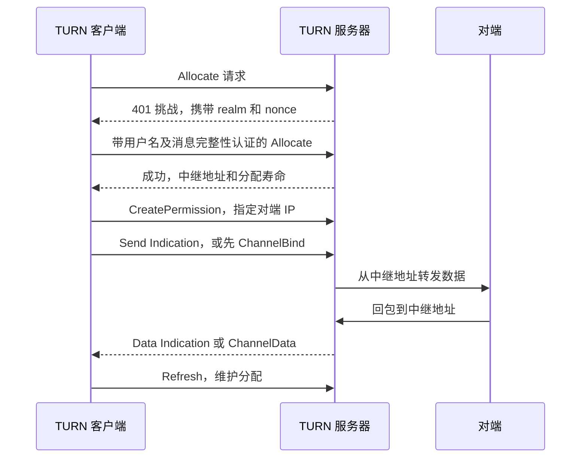

# STUN、ICE、TURN 原理与流程

返回 [[70-项目/01-CWNAS/02-相关知识/网络穿透/00-网络穿透知识导航|知识导航]]。先读 [[70-项目/01-CWNAS/02-相关知识/网络穿透/02-NAT行为与打洞原理|NAT 行为与打洞原理]]，更容易理解候选地址为什么需要逐一检查。

## 1. 三者各是什么

| 名称 | 由谁实现、部署或创建 | 负责什么 | 与相近概念的区别 |
| --- | --- | --- | --- |
| STUN：NAT 会话穿越工具 | 客户端协议栈实现请求/响应；运营方可部署 STUN 服务器 | 发现服务器观察到的源地址，也为 ICE 检查提供报文机制 | 不承担持续业务中继，也不是一个完整穿透方案 |
| ICE：交互式连接建立 | 由两端协议栈各自运行，应用提供相关服务器配置及信令 | 收集地址、组织候选对、检查连通性并选出路径 | 是协调过程，不是一台专门转发文件的服务器 |
| TURN：使用中继穿越 NAT | 两端按需使用 TURN 客户端；运营方部署 TURN 服务器 | 分配中继地址，并在客户端和对端之间转发数据 | 解决直接路径不可用时的可达性，消耗服务器资源 |
| 信令服务 | 由产品开发者设计、部署 | 交换会话描述、候选和应用控制消息 | 传递“如何连接”的信息，不必承载连接后的业务字节 |

前三项依据各自 RFC；信令的具体传输形式由应用选择，WebRTC 并没有要求某个统一的业务信令接口。[^S10][^S11][^S13][^S17]

## 2. STUN：知道某个观察点眼中的自己

常见流程是客户端向 STUN 服务发送 **Binding 请求**，即询问本次通信的地址映射；服务端响应中的 `XOR-MAPPED-ADDRESS` 携带它看到的源地址和端口。“XOR”表示地址字段的编码处理，**不表示这份响应提供了业务内容加密**。[^S10]

```text
客户端本地：192.168.1.10:50000
STUN 服务：203.0.113.80:3478
STUN 观察到的来源：198.51.100.20:41000
```

这个结果有三个边界：

- 它描述这条传输和这个观察点，可能受 NAT 映射行为影响。
- 它不能证明另一台设备可从任意网络访问这个地址。
- 它不自动判断完整 NAT 类型；RFC 8489 本身不是一个完整的 NAT 行为分类测试方案。[^S10]

ICE 的连通性检查也使用经过认证的 STUN 消息，因此日志里出现 STUN，可能是在和发现服务器交互，也可能是端点之间正在检查路径，应结合目标地址与会话阶段判断。[^S11]

## 3. ICE：让候选地址接受实际检查

**ICE agent** 是运行在某一端的 ICE 协议实体，由浏览器或通信库创建，负责该端的候选和检查状态。**候选（Candidate）** 是一个可尝试的传输地址及相关属性，由 agent 收集或在检查中发现。**候选对（Candidate Pair）** 是一个本地候选和一个远端候选组成的尝试路径；它不是两个用户账号的绑定关系。[^S11]

### 3.1 候选类型

| 类型 | 如何产生 | 举例与边界 |
| --- | --- | --- |
| `host` | 从本端接口等本地传输地址产生 | 局域网或全球地址；浏览器为隐私可能使用 mDNS 名称代替直接暴露局域网 IP |
| `srflx`：服务器反射候选 | 从 STUN 等服务器观察到的映射产生 | 例如家庭网关的外侧地址与端口 |
| `prflx`：对端反射候选 | 在连通性检查中观察到此前未列出的地址 | 是检查中动态发现的路径信息，不要求预先通过信令完整列出 |
| `relay`：中继候选 | 向 TURN 申请分配得到 | 使用该地址会涉及中继转发；分配产生不等于最终选用 |

**mDNS** 是局域网多播域名解析机制；浏览器可以生成临时名称来减少向网页暴露本地地址。能否使用这些候选还取决于对端和网络支持，不能看到 `.local` 就直接认定候选错误。[^S11][^S35]

### 3.2 从收集到选中

1. 两端创建 ICE agent，配置 STUN/TURN 等收集条件。
2. 收集本地候选，并通过应用信令交换必要信息。
3. 将兼容的本地和远端候选组成检查列表，依据优先级组织检查。
4. 向候选对发送 STUN 连通性检查，验证路径是否双向可用。
5. 控制角色一方按协议提名可用候选对，形成选中路径。
6. WebRTC 等上层在该路径上继续建立安全传输和数据通道。[^S11][^S16]

**控制角色（Controlling）与被控角色（Controlled）** 是 ICE 为协调候选提名设置的协议角色，由双方协商及冲突处理决定。它们不等于 NAS 管理员和普通用户，也不能用来推导业务权限。[^S11]

**Trickle ICE** 指候选一边收集、一边经信令发送，而不是全部收集结束后再统一交换。该方式由通信库和应用信令配合实现，有助于让检查更早开始；接收端仍必须把候选对应到正确会话及本次 ICE 参数。[^S12]

### 3.3 “直连优先、失败回退”应怎样理解

这是产品目标的概括，不一定是两段完全串行的程序。允许全部候选的 ICE 可以在同一过程中收集和检查直接候选、中继候选；优先级、检查进度、提名策略和网络状况共同决定实际使用的路径。为了“等直连”而过晚准备中继，可能增加首连等待，这属于需要测量的产品取舍。[^S11][^S12]

浏览器的 `iceTransportPolicy: "all"` 允许使用多类候选；`"relay"` 将可用候选限制为中继候选，可用于隐私需求或中继链路验证。`"all"` 本身不是“保证直连”的设置。[^S19]

## 4. TURN：中继资源如何产生并工作

**Allocation（分配）** 是 TURN 服务为客户端建立的中继资源，服务端创建和维护，客户端负责按协议刷新。**Permission（许可）** 是分配内部允许与某个对端 IP 通信的协议状态。**ChannelBind（通道绑定）** 将一个短通道号与对端传输地址关联，便于用更紧凑的 `ChannelData` 帧搬运数据。它们都不是 NAS 的用户登录会话。[^S13]

典型长期凭据认证及数据传输过程如下；某些客户端持有有效挑战信息时，报文往返可有差别。



`realm` 是服务声明的认证域，`nonce` 是认证挑战中的随机性/时效相关值，均由服务端提供；客户端据此与凭据共同计算消息完整性。初次 401 常是预期挑战，连续认证失败才需要结合错误码、配置和抓包判断。[^S13]

分配、Permission、ChannelBind 各有生命周期和刷新要求，不能只刷新一个对象就认定其他对象也永久有效。客户端以服务响应和协议状态为准，关闭或停止刷新后服务端需要回收对应资源。[^S13]

### 4.1 客户端入口端口与中继端口不同

```text
客户端
  ↕ 连接 TURN 的入口，如 UDP/TCP 3478 或 TLS 5349
TURN 协议服务
  ↕ 按部署配置分配中继地址和端口
对端
```

**URI（统一资源标识符）** 在这里是应用配置 TURN 地址的字符串，由管理员或平台提供，描述服务名称、端口及传输等信息；它与服务实际分配的中继地址不同。TURN URI 的默认端口取决于是否使用安全方案：普通 TURN 通常使用 `3478`，`turns` 默认使用 `5349`；实际可以由管理员另行配置。入口端口用于客户端访问服务，中继端口用于服务与对端交换数据，两者不能混为一谈。部署在云 NAT 后时，还应保证返回的中继地址和外部映射一致。[^S14][^S29]

**“通过 TCP 连接 TURN”描述客户端到 TURN 的一段传输。** 它不能单独证明 TURN 到对端也使用 TCP。典型 WebRTC 中继中，这两段可以分别是 TCP/TLS 和 UDP；TCP 中继分配属于另外的扩展能力，不应从一个 `transport=tcp` 参数直接推断。[^S13][^S16]

### 4.2 中继是否能读到文件内容

TURN 主要转发客户端和对端的数据，并不自动提供应用级端到端加密。WebRTC DataChannel 在 TURN 内搬运的业务内容受 DTLS 等协议保护；运营方通常仍可看到连接时间、地址、包长和流量等元数据。**DTLS** 是面向数据报的安全传输协议，由两端协议栈执行，负责该连接的加密和完整性保护；长期设备身份与用户权限仍由应用验证。[^S13][^S15][^S17]

“中继看不到正常业务明文”也不代表可以忽略信令可信度：如果应用缺少独立身份绑定，攻击者可能通过篡改协商信息诱导连接错误的对端。[^S17]

## 5. 最容易写错的结论

| 说法 | 应采用的判断方式 |
| --- | --- |
| STUN 成功，所以 P2P 必成 | 继续进行端点之间经过认证的候选对检查 |
| 有 relay 候选，所以正在中继 | 查看实际选中候选对及对应流量 |
| 有两个 TURN 分配，所以有两个在线用户 | 分配属于协议资源，数量与用户/业务会话无固定一一关系 |
| 开放 TURN 入口就够了 | 同时检查中继端口、外部地址映射和对端可达性 |
| TURN Permission 就是文件访问权限 | 另外进行设备身份验证和 NAS 业务鉴权 |

这些区分分别来自 ICE、TURN 和 WebRTC 统计的对象定义。[^S11][^S13][^S20]

下一篇：[[70-项目/01-CWNAS/02-相关知识/网络穿透/04-WebRTC数据通道与连接生命周期]]。

[^S10]: [[70-项目/01-CWNAS/02-相关知识/网络穿透/08-参考资料#S10|S10：RFC 8489]]。
[^S11]: [[70-项目/01-CWNAS/02-相关知识/网络穿透/08-参考资料#S11|S11：RFC 8445]]。
[^S12]: [[70-项目/01-CWNAS/02-相关知识/网络穿透/08-参考资料#S12|S12：RFC 8838]]。
[^S13]: [[70-项目/01-CWNAS/02-相关知识/网络穿透/08-参考资料#S13|S13：RFC 8656]]。
[^S14]: [[70-项目/01-CWNAS/02-相关知识/网络穿透/08-参考资料#S14|S14：RFC 7065]]。
[^S15]: [[70-项目/01-CWNAS/02-相关知识/网络穿透/08-参考资料#S15|S15：RFC 8831]]。
[^S16]: [[70-项目/01-CWNAS/02-相关知识/网络穿透/08-参考资料#S16|S16：RFC 8835]]。
[^S17]: [[70-项目/01-CWNAS/02-相关知识/网络穿透/08-参考资料#S17|S17：RFC 8827]]。
[^S19]: [[70-项目/01-CWNAS/02-相关知识/网络穿透/08-参考资料#S19|S19：W3C WebRTC 接口规范]]。
[^S20]: [[70-项目/01-CWNAS/02-相关知识/网络穿透/08-参考资料#S20|S20：W3C WebRTC 统计接口]]。
[^S29]: [[70-项目/01-CWNAS/02-相关知识/网络穿透/08-参考资料#S29|S29：coturn 官方配置说明]]。
[^S35]: [[70-项目/01-CWNAS/02-相关知识/网络穿透/08-参考资料#S35|S35：RFC 8828 与浏览器 mDNS 候选说明]]。
