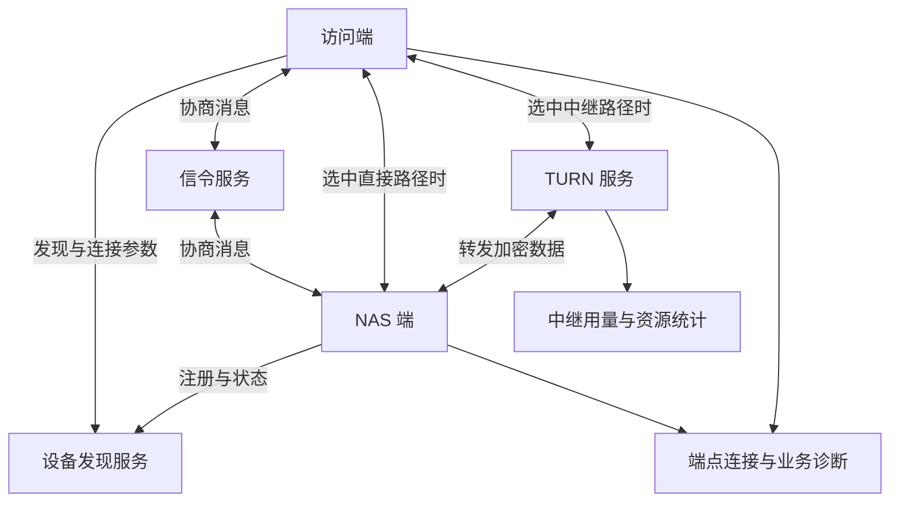

# CWNAS 穿透架构设计参考

返回 [[70-项目/01-CWNAS/02-相关知识/网络穿透/00-网络穿透知识导航|知识导航]]。

**本篇是基于协议知识提出的设计参考，不是本次对 CWNAS 源码或线上部署的审计结论。** 项目背景来自 [[70-项目/01-CWNAS/01-设计文档/TURN-WEBRTC-GUIDE|2026-09-11 的 WebRTC/TURN 历史笔记]]；其中记录的包路径、缺陷和端口只代表当时快照。

## 1. 建议的组件及职责

下列名称是为了说明设计职责，并不要求项目必须创建同名包或服务。

| 名称 | 是什么、由谁创建或配置 | 负责什么 | 与相邻职责的区别 |
| --- | --- | --- | --- |
| 访问端 | 浏览器、手机端或桌面端，由用户运行 | 选择设备、发起连接、提交业务请求 | 不是公网平台本身 |
| NAS 端 | 运行在 NAS 的连接与业务程序，由设备安装和管理 | 接收连接、证明设备身份、处理本地请求 | 网络入口可用不代表业务权限已通过 |
| 设备目录/发现服务 | 平台提供的目标查询能力，由平台维护设备记录 | 回答目标的逻辑标识、在线信息和可用入口 | 在线状态属于观测，不是对端长期身份证明 |
| 信令服务 | 平台承接的会话协商服务，由平台部署 | 路由 Offer、Answer、候选和关闭消息 | 不应混同于文件数据转发器 |
| STUN 服务 | 公网地址发现/检查服务，由运营方或第三方提供 | 提供映射观测等工具 | 不持续转发文件 |
| TURN 服务 | 公网中继组件，由运营方部署 | 创建和刷新分配、转发字节、限制资源 | 不理解文件权限，不天然识别预期 NAS |
| 设备信任层 | 应用验证设备身份的逻辑，由产品定义和设备密钥支撑 | 确认“我连接的是预期那台 NAS” | 不等于验证当前 NAS 用户账号 |
| 业务鉴权层 | NAS 的登录及权限系统，由设备管理员和应用配置 | 判断谁能读写哪项文件或操作 | 不因网络通道已加密而省略 |
| 计量与诊断 | 端点和平台记录的受控观测，由各组件采集 | 连接阶段、路径、用量、失败分类 | 不能用单一服务器计数推导全部业务行为 |

STUN/ICE/TURN 的边界依据相关标准；设备身份和信令信任的区分依据 WebRTC 安全架构。其余职责拆分属于本篇的工程建议。[^S10][^S11][^S13][^S17]

## 2. 区分控制消息与业务数据

**控制平面** 是负责“连接谁、怎样协商、何时关闭”的消息和状态，由平台及端点共同维护。**数据平面** 是承载文件或请求内容的路径，由选中的直连/中继通道搬运。两者是职责划分，并不要求一定部署在不同服务器。



示意图省略了多中继及具体协议封装。TURN 路径可以是一侧中继，也可以涉及两侧分配；只在一端分配成功不等于双方都已中继，更不等于业务身份已通过。[^S11][^S13]

## 3. 三种身份和凭据不要混用

| 对象 | 建议由谁管理 | 应证明什么 | 不能代替什么 |
| --- | --- | --- | --- |
| 路由标识 | 平台和端点按连接状态登记 | 某条信令连接可接收目标别名的消息 | 长期设备身份 |
| 设备密钥及证书/指纹 | 设备持有私钥，用户或信任系统保存绑定 | 对端持有预期设备的身份凭据 | NAS 账号操作权限 |
| NAS 用户会话 | NAS 登录及权限系统 | 当前用户可执行具体业务操作 | TURN 用量授权 |
| TURN 凭据 | 中继授权服务签发，TURN 校验 | 本次允许使用哪些中继资源 | 访问 NAS 文件的资格 |
| 分享链接或接入码 | 业务/平台按产品语义签发 | 对指定对象、期限和操作的授权 | 默认全部设备权限 |

**信任绑定** 指把用户预期的设备，与其长期密钥或其他可验证标识建立联系。首次绑定、变更、撤销和设备恢复需要明确规则，不能把任意信令中带来的一个名字直接当作可信设备。

WebRTC 的 DTLS 指纹校验依赖协商信息；若协商来源或应用身份绑定不可信，只验证“协商所指的证书”并不能自动等于验证“用户原本想访问的 NAS”。[^S17]

## 4. 建议的连接状态与资源所有权

```text
待连接
  → 发现目标
  → 信令就绪
  → 连接协商和候选检查
  → 数据通道打开
  → 设备身份验证通过
  → NAS 业务授权通过
  → 业务传输
  → 关闭并回收

任一阶段失败 → 记录具体原因 → 回收本次资源 → 按策略重试或结束
```

建议每次协商创建独立 **会话（Session）**，由端点的连接管理逻辑持有；会话统一关联连接对象、候选队列、取消操作和阶段时限。它与用户登录会话、TURN allocation 都应使用不同概念，避免生命周期混乱。

建议分别约束三种时间：连接总时限、单阶段时限、业务请求时限。若每个子步骤都独立从头获得完整超时，可能使总等待时间超出用户预期；由上层总时限约束子阶段更容易控制。

关闭时应明确谁负责关闭数据通道、连接对象、计时器和候选队列，谁只借用共享信令客户端。新会话的候选不能误投旧对象；发生晚到消息时，应根据会话编号和本次 ICE 参数识别归属。

这些是资源组织建议；实际接口顺序仍应符合所使用的浏览器或通信库。[^S19]

## 5. TURN 授权与资源保护

基于 TURN 的资源模型，建议授权系统明确以下内容。[^S13]

- **签发入口的权限**：谁可以拿到凭据，是否必须先证明设备或访问资格，凭据归属什么用户/租户/设备。
- **有效期和时间同步**：短期凭据可以限制泄漏后的使用窗口；动态用户名格式与签名机制属于具体实现约定，不是所有 TURN 服务通用的标准格式。
- **资源上限**：并发分配、分配速率、带宽和可用端口分别限制；只签一个短期密码不能代替全部配额。
- **目标限制**：防止凭据被用于访问不应触达的内网、环回、链路本地或云元数据目标，规则需结合业务拓扑配置和验证。
- **日志处理**：记录可关联的凭据编号或归属摘要，避免输出密码、签名密钥和完整敏感协商内容。

coturn 支持带时间信息的共享密钥认证等机制，也提供分配和网络访问限制选项；具体参数按所用版本核对。本篇不提供一份可以直接套用的生产配置，以免将示例地址和资源范围当成项目事实。[^S29]

**凭据到期、已有 allocation 到期、用户访问权撤销是不同事件。** 如要求“撤销立即生效”，需要设计已有分配与应用连接的终止行为，不能只依赖下一次新分配请求被拒绝。[^S13][^S29]

## 6. 计量时要说明计算对象

| 观测位置 | 可计量内容 | 适用目的及限制 |
| --- | --- | --- |
| 业务层 | 文件内容字节、请求次数、成功块 | 最接近用户业务；需要处理重试、重复请求和取消 |
| DataChannel/连接层 | 发送接收、缓冲、路径及相关统计 | 判断通道工作情况；字段含义按接口定义 |
| TURN 分配或中继 socket | 该中继资源搬运的字节和存续状态 | 观察中继资源；看不到未经过本机的直连流量 |
| 网卡或云账单 | 某接口或计费边界的总流量 | 容量与成本核算；会混入封装、重传和其他服务 |

本表是观测设计建议，协议统计对象可参考 W3C `getStats()` 和 TURN 分配模型。[^S13][^S20]

例如业务发送一个 100 MiB 文件，重试部分块后业务层可能累计读取更多内容；中继层还包含封装和网络重传。一个统计页面必须明确显示“文件大小”“业务发送累计”还是“中继网络字节”，并声明时间窗口、方向和是否去重。

## 7. 建议保留的诊断字段

字段名仅为示例，使用简单词义表达目的：

| 字段示例 | 含义与产生位置 | 注意事项 |
| --- | --- | --- |
| `session_id` | 本次连接编号，由创建会话的一方产生并按协议关联 | 不当作永久设备编号 |
| `device_id` | 应用认定的目标设备标识 | 说明身份验证前后可信程度 |
| `stage`、`error` | 当前阶段和可分类错误，由对应组件记录 | 避免所有失败都叫“穿透失败” |
| `local_type`、`remote_type` | 选中候选的类型，由传输统计产生 | 区别于全部已收集候选 |
| `rtt_ms` | 观测窗口内的往返时间 | 记录统计来源，避免当成单程时延 |
| `sent_bytes`、`received_bytes` | 明确计量层次的累计值 | 标注重置点、窗口和采样时间 |
| `close_reason` | 主动取消、超时、网络错误等关闭原因 | 支持排查晚到事件及重复关闭 |

## 8. 如何使用项目历史笔记

2026-09-11 的历史笔记描述了当时的 `pkg/net/webrtc`、`signaling`、`turn` 和 HTTP tunnel 相关包。**Go 包** 是项目按目录组织的一组源码及导出接口，由开发者维护；目录嵌套并不自动决定运行时部署关系。

历史材料特别适合引导复核三类问题：每会话配置是否在真正创建收集器时生效；凭据签发是否在所有入口有一致授权；分配和中继流量是否与实际业务正确关联。它记载的测试只证明对应日期、版本和输入下的行为。本次仅补充知识文档，未执行源码验证或部署验收。

下一篇：[[70-项目/01-CWNAS/02-相关知识/网络穿透/07-部署检查与故障排查]]。

[^S10]: [[70-项目/01-CWNAS/02-相关知识/网络穿透/08-参考资料#S10|S10：RFC 8489]]。
[^S11]: [[70-项目/01-CWNAS/02-相关知识/网络穿透/08-参考资料#S11|S11：RFC 8445]]。
[^S13]: [[70-项目/01-CWNAS/02-相关知识/网络穿透/08-参考资料#S13|S13：RFC 8656]]。
[^S17]: [[70-项目/01-CWNAS/02-相关知识/网络穿透/08-参考资料#S17|S17：RFC 8827]]。
[^S19]: [[70-项目/01-CWNAS/02-相关知识/网络穿透/08-参考资料#S19|S19：W3C WebRTC 接口规范]]。
[^S20]: [[70-项目/01-CWNAS/02-相关知识/网络穿透/08-参考资料#S20|S20：W3C WebRTC 统计接口]]。
[^S29]: [[70-项目/01-CWNAS/02-相关知识/网络穿透/08-参考资料#S29|S29：coturn 官方文档]]。
